# 02 · Modelo de datos y contratos de integridad

> Alcance actualizado: este documento describe el producto completo. La primera implementación es el [buscador PWA estático](14_Plan_PWA_estatica.md), sin backend ni base de datos. Para esa entrega prevalecen los documentos 14-16; se conservan aquí las especificaciones compatibles y la evolución posterior.

**Estado:** especificación v1.1, 25 de octubre de 2026, ajustada a las [decisiones confirmadas](13_Decisiones_confirmadas.md). Define conocimiento clínico para formación y consulta documental en España, primero en un espacio privado de su propietario. Incluye adultos y pediatría y contenido clínico español/inglés en el piloto; no define una historia clínica ni admite datos de pacientes reales.

## 1. Decisiones de arquitectura

- **MariaDB es la base canónica de producción.** SQLite sirve para las pruebas rápidas de lógica; las pruebas de consultas, índices, JSON, restricciones y concurrencia también se ejecutan contra MariaDB 11. No se presume equivalencia de los dos motores.
- **Modelo relacional con contenido versionado común.** `content_items` identifica un recurso a lo largo de su vida; `content_revisions` representa una versión concreta. Enfermedades, hallazgos, pruebas, preguntas, casos y algoritmos comparten este contrato. Sus datos específicos se guardan en tablas tipadas dependientes de la revisión.
- **Espacio personal inicial y actividad con ámbito.** Sólo el propietario tiene acceso activo al piloto; registro público, grupos y actividad institucional permanecen deshabilitados. Se conservan `organizations` y `memberships` con una organización personal para evitar rehacer después intentos y notas. La apertura futura requerirá alta aprobada, revisión de permisos de contenido y pruebas de aislamiento; el esquema no habilita esa apertura por sí mismo.
- **La taxonomía clínica se organiza por problemas y competencias con guías actuales como estructura principal.** Las secciones y los capítulos del libro son una clasificación documental secundaria. Se conserva su mapa de páginas, pero no se obliga a que un problema pertenezca a una sola sección ni a que una ficha derive del libro. Las guías aún deben seleccionarse, versionarse y revisarse; no hay un corpus de guías aprobado por haber definido el esquema.
- **La fuente se conserva y la transcripción se contrasta.** El inventario existente contiene 1.101 páginas, 23 secciones clínicas, preliminares y casos clínicos, 198 capítulos y 45 casos. El Markdown es auxiliar y las 32 páginas con OCR requieren control. El índice actual indica que el OCR está en el Markdown y que los PDF conservan su capa original.
- **Una asociación no es una regla diagnóstica.** La base expresa en qué contexto un hallazgo o resultado apoya una hipótesis y con qué evidencia. No contiene una columna `prueba_positiva = enfermedad_confirmada`.
- **Sin IA en las primeras versiones.** Búsqueda relacional y FULLTEXT, normalización determinista y autoría/revisión humanas. Sin embeddings, generación automática ni servicios externos de IA; se describe en [03_Busqueda_y_conocimiento_clinico.md](03_Busqueda_y_conocimiento_clinico.md).
- **Preservación privada y contenido clínico reutilizable son capas distintas.** Convertir PDF en filas, Markdown o gráficos no acredita derechos de reutilización. Los textos e imágenes del libro se mantienen con acceso personal restringido, sin permiso de distribución acreditado. Las fichas clínicas originales y sus usos requieren evaluación de procedencia, licencias y alcance según [04_Ingesta_y_gobierno_del_contenido.md](04_Ingesta_y_gobierno_del_contenido.md). Esta actualización documental no realiza nuevas extracciones ni carga la base.

## 2. Convenciones obligatorias

| Convención | Especificación |
| --- | --- |
| Clave interna | `id BIGINT UNSIGNED` autoincremental; SQLite usa su entero de 64 bits. Las FK tienen el mismo tipo que su destino. |
| Identidad pública | `public_id CHAR(26)` ULID, único, no nulo e inmutable en recursos exportables. Comparación exacta; generación en la aplicación. |
| API y PWA | Los contratos usan nombres explícitos `item_public_id`, `revision_public_id`, `attempt_public_id`. No se expone una FK interna bajo esos nombres. |
| Fechas | UTC en persistencia; fecha civil separada cuando corresponda. API ISO 8601. La interfaz convierte a la zona del usuario. |
| Texto | UTF-8 completo, `utf8mb4` en MariaDB. El original y la representación normalizada de búsqueda son campos distintos. |
| Traducciones | JSON por locale con `spatie/laravel-translatable`; revisión por idioma. Español e inglés clínicos revisados desde el piloto; el sistema conserva español como idioma de autoría inicial. Árabe y darija en dos alfabetos se preparan técnicamente y se incorporarán después. |
| Números | `DECIMAL`, nunca `FLOAT` para límites, medidas y probabilidades almacenadas; unidad, comparador y contexto explícitos. |
| Estados | `VARCHAR` con enum PHP respaldado y `CHECK` cuando lo soporte la migración. No depender de `ENUM` de MariaDB para lógica compartida. |
| JSON | Metadatos, traducciones y estructuras con esquema versionado. Relaciones, filtros y claves de negocio se modelan con columnas/FK. |
| Versiones de esquema | `schema_version`, `payload_schema_version`, `engine_schema_version`, `state_schema_version`, `selection_schema_version` e `index_schema_version` se guardan como `VARCHAR(32)` —por ejemplo `1.0`— y se comparan mediante un registro de compatibilidad, no como números decimales. `revision_no` sigue siendo entero. |
| Borrados | `RESTRICT` en fuentes, revisiones y evidencias publicadas; retiradas lógicas con motivo. `CASCADE` sólo en componentes de borradores eliminables. |
| Tiempos comunes | `created_at`, `updated_at`; `created_by` cuando exista autoría. Las tablas de relación puras pueden omitir ULID y usar clave compuesta. |
| Concurrencia | `lock_version` en edición, transacciones y bloqueo de fila al publicar. Conflicto de edición devuelve 409 con comparación de versiones. |

Los campos traducibles se consultan mediante la biblioteca y un adaptador probado para ambos motores; no se realiza FULLTEXT sobre el JSON. Las traducciones se proyectan a filas de búsqueda por idioma. La documentación de Spatie describe el almacenamiento JSON y las diferencias de consulta en MariaDB. [Spatie: requisitos](https://spatie.be/docs/laravel-translatable/v6/requirements), [consultas de traducciones](https://spatie.be/docs/laravel-translatable/v6/basic-usage/querying-translations).

## 3. Diagrama de relaciones principales

```mermaid
erDiagram
    ORGANIZATIONS ||--o{ MEMBERSHIPS : contiene
    USERS ||--o{ MEMBERSHIPS : pertenece
    MEMBERSHIPS ||--o{ LEARNING_ATTEMPTS : realiza
    SOURCES ||--o{ SOURCE_DOCUMENTS : tiene
    SOURCE_DOCUMENTS ||--o{ SOURCE_PAGES : pagina_original
    SOURCE_DOCUMENTS ||--o{ DOCUMENT_PAGE_MAPS : pagina_derivada
    SOURCE_PAGES ||--o{ DOCUMENT_PAGE_MAPS : conserva
    SOURCE_PAGES ||--o{ PAGE_EXTRACTIONS : extraida_como
    SOURCE_PAGES ||--o{ SOURCE_LOCATORS : localiza
    SOURCES ||--o{ SOURCE_RIGHTS_RECORDS : documenta_usos
    BOOK_SECTIONS ||--o{ CHAPTERS : agrupa
    CHAPTERS ||--o{ CHAPTER_PAGE_SPANS : ocupa
    CLINICAL_TOPICS ||--o{ REVISION_TOPICS : clasifica
    CONTENT_REVISIONS ||--o{ REVISION_TOPICS : aborda
    CONTENT_ITEMS ||--o{ CONTENT_REVISIONS : versiona
    CONTENT_REVISIONS ||--o{ REVISION_CITATIONS : fundamenta
    SOURCE_LOCATORS ||--o{ REVISION_CITATIONS : ubica
    CONTENT_REVISIONS ||--o{ REVIEW_EVENTS : recibe
    CONTENT_REVISIONS ||--o{ REVISION_DEPENDENCIES : depende
    CONTENT_ITEMS ||--o| CONDITIONS : identifica
    CONTENT_ITEMS ||--o| FINDINGS : identifica
    CONTENT_ITEMS ||--o| DIAGNOSTIC_TESTS : identifica
    CONTENT_REVISIONS ||--o| TEST_REVISION_DATA : especifica
    CONTENT_REVISIONS ||--o| ASSERTION_REVISION_DATA : afirma
    CONTENT_REVISIONS ||--o| RESULT_PATTERN_REVISION_DATA : caracteriza
    CONTENT_REVISIONS ||--o| QUESTION_REVISION_DATA : pregunta
    CONTENT_REVISIONS ||--o| CASE_REVISION_DATA : caso
    CONTENT_REVISIONS ||--o| ALGORITHM_REVISION_DATA : algoritmo
    CONTENT_REVISIONS ||--o{ SEARCH_DOCUMENTS : proyecta
    CONTENT_REVISIONS ||--o{ ATTEMPT_ITEMS : congela
    LEARNING_ATTEMPTS ||--o{ ATTEMPT_ITEMS : contiene
```



El diagrama muestra cardinalidades, no sustituye las restricciones del diccionario. `content_items.published_revision_id` debe referirse a una revisión del mismo ítem. Lo mismo se exige a todos los pares ítem/revisión; se valida en el servicio de dominio y con pruebas de integración.

## 4. Diccionario: fuentes, páginas y procedencia

| Tabla | Columnas específicas y relaciones | Restricciones y propósito |
| --- | --- | --- |
| `sources` | `id`, `public_id`, `kind`, `title`, `authors_json`, `edition`, `publication_year SMALLINT`, `publisher`, `canonical_url`, `retrieved_at`, `rights_status`, `rights_notes`, `source_version`, `sha256` nullable, `supersedes_source_id FK?`, `issued_at?`, `jurisdiction`, `population_scope` | Una edición o versión identificable por registro. `kind`: libro, guía, artículo, protocolo, documento original o conjunto terminológico. Una actualización de guía crea otra versión fuente; fecha reciente no equivale por sí sola a aprobación clínica. |
| `source_rights_records` | `id`, `public_id`, `source_id FK`, `document_id FK?`, `asset_locator_id FK?`, `use_type`, `audience`, `territory`, `license_identifier?`, `license_url?`, `attribution_text?`, `evidence_media_id FK?`, `assessment_status`, `assessed_by FK?`, `assessed_at?`, `valid_until?`, `notes` | Registro de evaluación por uso: almacenamiento privado, indexación, reproducción, adaptación, traducción, exportación y paquete offline son usos distintos. Estado inicial del libro: distribución no acreditada y restricción personal. Una cita no concede todos los usos; el registro de una evaluación no inventa una autorización. |
| `source_documents` | `source_id FK`, `parent_document_id FK?`, `media_id FK`, `role`, `filename`, `mime_type`, `byte_size BIGINT`, `page_count INT`, `sha256 CHAR(64)` | Original, sección derivada o adjunto. `UNIQUE(source_id, sha256)`. El PDF original no se sobrescribe. Ficheros privados mediante Media Library y rutas autorizadas. |
| `source_pages` | `original_document_id FK`, `file_page_no INT`, `printed_page_label VARCHAR?`, `has_text_layer BOOL`, `render_hash CHAR(64)?` | Sólo páginas del documento original, numeradas desde 1. `UNIQUE(original_document_id, file_page_no)`, `file_page_no > 0` y dentro de `page_count`. La etiqueta impresa nunca sustituye al número real. |
| `document_page_maps` | `document_id FK`, `local_page_no INT`, `source_page_id FK` | `UNIQUE(document_id, local_page_no)`. Cada página derivada resuelve a una página original; no calcular desplazamientos de manera implícita. |
| `extraction_runs` | `document_id FK`, `tool_name`, `tool_version`, `settings_json`, `started_at`, `completed_at`, `status`, `input_sha256`, `manifest_sha256` | Extracción reproducible. Registra herramienta y parámetros, sin atribuir exactitud clínica al OCR. |
| `page_extractions` | `source_page_id FK`, `extraction_run_id FK`, `method`, `raw_text LONGTEXT`, `normalized_text LONGTEXT`, `ocr_confidence DECIMAL(6,5)?`, `review_status`, `reviewed_by FK?`, `reviewed_at?`, `text_sha256` | `UNIQUE(source_page_id, extraction_run_id)`. `method`: capa PDF, OCR o transcripción manual. La confianza técnica no equivale a revisión médica. |
| `source_locators` | `source_id FK`, `first_source_page_id FK?`, `last_source_page_id FK?`, `url?`, `section_label?`, `figure_label?`, `bounding_boxes_json?`, `extraction_id FK?`, `text_anchor_hash?` | Página o tramo real inclusivo; o localizador web estructurado. Página final ≥ inicial y mismo original/fuente. Coordenadas opcionales normalizadas `[0,1]` por página. |
| `book_sections` | `source_id FK`, `ordinal SMALLINT`, `code VARCHAR`, `title JSON`, `derived_document_id FK?` | `UNIQUE(source_id, ordinal)`; mantiene la clasificación actual. No generar secciones clínicas para material preliminar. |
| `chapters` | `content_item_id FK UNIQUE`, `source_id FK`, `section_id FK`, `chapter_number VARCHAR?`, `ordinal INT` | La identidad del capítulo es un recurso versionable y se conserva aunque cambie su título. |
| `chapter_page_spans` | `chapter_id FK`, `first_source_page_id FK`, `last_source_page_id FK`, `ordinal INT` | Permite capítulos con varios tramos, figuras o anexos; no supone que todos sean contiguos. |
| `import_batches` | `public_id`, `source_id FK`, `manifest_sha256`, `pipeline_version`, `status`, `counts_json`, `validation_report_media_id FK?` | Importación por lote, con claves de idempotencia y registro de errores. Una reimportación idéntica no duplica contenido. |

`source_revision` significa la versión identificada de una fuente externa; no significa revisión médica. Se guarda en `sources.source_version` y en el manifiesto de importación. El contenido del libro de 2018 mantiene su procedencia histórica. Las guías actuales sustentan la estructura principal de las fichas; el libro aporta consulta secundaria y comparación, con discrepancias visibles. No se crea una supuesta licencia libre para el libro ni se declara autorizada la distribución por estar en una base de datos.

`source_rights_records` se valida además con las Policies de usuario y ámbito: una evaluación favorable para un uso no equivale a acceso universal. Los componentes de una publicación o paquete se comprueban uno a uno, incluidas figuras y traducciones. Ante ausencia de evaluación suficiente se bloquea ese uso; la conservación del archivo privado existente se trata separadamente en el documento 04.

`sources.rights_status` y `rights_notes` son un resumen de inventario; la decisión por uso procede de los registros detallados y no se deduce de ese resumen. Una evaluación vencida o de otra audiencia no habilita el uso. La decisión sobre lectura de la fuente y la relativa a una ficha original con sus propios permisos se evalúan separadamente, sin atribuir a la ficha todos los derechos de la fuente ni bloquear automáticamente un mero enlace bibliográfico autorizado.

### Taxonomía principal independiente del libro

| Tabla | Columnas específicas y relaciones | Restricciones y propósito |
| --- | --- | --- |
| `clinical_topics` | `id`, `public_id`, `stable_key UNIQUE`, `parent_id FK?`, `title JSON`, `kind`, `status`, `lock_version` | Navegación por problema, área o competencia. Árbol sin ciclos; cambios de clasificación auditados. No sustituye las afirmaciones clínicas versionadas. |
| `revision_topics` | `revision_id FK`, `topic_id FK`, `relation_kind`, `display_order` | Clave compuesta; una ficha puede participar en varios problemas. Es la clasificación principal de consulta y selección temática. |
| `topic_objectives` | `topic_id FK`, `objective_id FK`, `display_order` | Relaciona navegación clínica y competencias docentes sin confundir objetivos con diagnósticos. |
| `topic_source_mappings` | `topic_id FK`, `source_id FK`, `book_section_id FK?`, `chapter_id FK?`, `locator_id FK?`, `mapping_relation`, `review_status` | Correspondencia secundaria a fuentes/versiones exactas. Una relación de clasificación no demuestra equivalencia ni aprobación clínica. Las referencias opcionales deben pertenecer a la misma fuente. |

La taxonomía se inicia con soporte vital, problemas cardiorrespiratorios y pruebas básicas, diferenciando adultos y pediatría. Son ámbitos de trabajo, no una lista de guías ya elegidas ni una validación de protocolos. La cobertura del piloto y sus fichas equivalentes en español/inglés se acuerdan por hitos; se mantiene disponible el inventario privado del resto del libro.

## 5. Diccionario: contenido, versiones y aprobación

| Tabla | Columnas específicas y relaciones | Restricciones y propósito |
| --- | --- | --- |
| `content_items` | `id`, `public_id`, `type`, `stable_key VARCHAR UNIQUE`, `canonical_locale`, `published_revision_id FK?`, `availability`, `lock_version INT` | Identidad permanente. `type` es inmutable: capítulo, ficha, enfermedad, hallazgo, prueba, contexto, patrón de resultado, intervalo, umbral, afirmación, pregunta, blueprint, caso, algoritmo, escala o recurso; procedimientos, intervenciones, medicamentos y pautas en ampliación. |
| `content_revisions` | `content_item_id FK`, `revision_no INT`, `supersedes_revision_id FK?`, `workflow_status`, `title JSON`, `summary JSON`, `body_markdown JSON`, `payload_json JSON?`, `payload_schema_version VARCHAR(32)`, `content_sha256`, `created_by FK`, `clinical_review_status`, `review_due_at?`, `published_at?`, `withdrawn_at?`, `change_summary TEXT` | `UNIQUE(content_item_id, revision_no)`. Texto y datos semánticos inmutables tras envío a revisión; las correcciones generan otra revisión. Estado de flujo y eventos pueden cambiar. `clinical_review_status`: `unreviewed`, `in_review`, `valid_for_scope`, `update_needed` o `withdrawn`; etiquetas traducidas en interfaz. |
| `revision_citations` | `revision_id FK`, `locator_id FK`, `support_type`, `supported_path VARCHAR`, `editor_note TEXT?` | Cita a una afirmación o fragmento concreto: `/rationale`, `/nodes/N1`, `/interpretation`. Distingue transcripción, sustento, contraste o discrepancia. Una cita general a un libro no valida todos los campos. |
| `revision_rights_assessments` | `revision_id FK`, `source_rights_record_id FK?`, `supported_path`, `derivation_kind`, `requested_use`, `audience`, `status`, `reviewed_by FK?`, `reviewed_at?`, `evidence_note` | Evaluación por fragmento/activo y uso previsto. Distingue redacción original, cita, reproducción, adaptación y traducción. Las fichas originales con fuentes requieren revisar también los elementos incorporados; una etiqueta de autoría propia no libera material ajeno. |
| `revision_dependencies` | `revision_id FK`, `depends_on_revision_id FK`, `dependency_type`, `required BOOL` | Clave única compuesta. Grafo sin dependencias circulares para paquetes de publicación. Distingue fundamento, traducción, derivación y componente docente. |
| `review_events` | `revision_id FK`, `actor_id FK`, `event_type`, `from_status`, `to_status`, `notes`, `changed_paths_json`, `created_at` | Historial inmutable. Aprobación médica y corrección editorial son eventos distintos. Quien escribió un cambio clínico crítico no lo aprueba en solitario. |
| `translation_reviews` | `revision_id FK`, `locale`, `source_text_sha256`, `status`, `reviewer_id FK?`, `reviewed_at?` | `UNIQUE(revision_id, locale)`. Una modificación del español invalida la aprobación de las traducciones afectadas. No mezclar traducción de interfaz con contenido médico. |
| `publication_events` | `content_item_id FK`, `revision_id FK`, `event_type`, `actor_id FK`, `effective_at`, `reason`, `release_id FK?` | Publicar, sustituir, retirar o restaurar mediante nueva decisión auditada. Ledger permanente. |
| `content_releases` | `public_id`, `version VARCHAR UNIQUE`, `manifest_media_id FK`, `manifest_sha256`, `released_at`, `minimum_client_version`, `status` | Conjunto reproducible de revisiones para web, preguntas y paquetes sin conexión. No es sinónimo de despliegue de código. |
| `release_items` | `release_id FK`, `content_item_id FK`, `revision_id FK` | `UNIQUE(release_id, content_item_id)`. La revisión pertenece al ítem y debe estar autorizada para ese lanzamiento. |
| `content_issues` | `revision_id FK`, `reporter_id FK?`, `category`, `severity`, `status`, `description`, `resolved_in_revision_id FK?` | Error de OCR, ambigüedad, actualización, fallo en algoritmo o cita. No borra intentos pasados ni reescribe una revisión ya usada. |

### Flujo de publicación

`draft → in_review → approved → published → superseded` o `withdrawn`.

1. El borrador puede editarse con control de concurrencia. Su cambio se audita. Enviar a revisión congela el contenido semántico.
2. Una devolución crea una nueva revisión corregida a partir de la anterior; el historial conserva el motivo. Las aprobaciones pertenecen a una revisión y un hash concretos.
3. La publicación exige estructura válida, citas resolubles, revisión de los fragmentos OCR utilizados, aprobación clínica para su alcance, revisión lingüística de los idiomas ofrecidos y evaluación de derechos para los usos de esa entrega. El contenido clínico del piloto exige español e inglés aprobados; un fallback no satisface esa condición.
4. Dosis, unidades, umbrales, contraindicaciones, ramas de algoritmos, respuestas correctas y explicaciones clínicas requieren revisor distinto del autor. El rol de administración técnica no equivale a aprobación médica.
5. `PublishContentRevision` bloquea el ítem, comprueba dependencias, marca la revisión anterior como `superseded`, actualiza el puntero publicado, registra los eventos y escribe un evento en `outbox_events` dentro de una transacción.
6. Tras confirmar la transacción, trabajos idempotentes regeneran la búsqueda y los manifiestos. Una consulta verifica siempre la revisión publicada vigente; un índice atrasado no puede devolver contenido retirado como vigente.
7. Retirar vacía o sustituye el puntero, registra motivo, bloquea nuevas sesiones docentes dependientes y genera invalidaciones. Los intentos previos conservan su revisión y muestran que fue retirada, con acceso según permisos de auditoría.
8. Las dependencias inversas producen una cola de impacto: preguntas, casos, algoritmos, traducciones y paquetes afectados. La sustitución de una cita no actualiza automáticamente sus derivados: requieren revisión.

La fecha de próxima revisión puede variar por criticidad y se acordará editorialmente. Una fecha no prueba vigencia; el estado clínico, las discrepancias conocidas y el alcance revisado son independientes.

El equipo de revisión está **pendiente de organizar**. El propietario puede catalogar, redactar y consultar material privado, pero no se desactiva la revisión independiente por ser el único usuario. Hasta disponer de revisor competente, los cambios críticos permanecen en borrador y no se etiquetan como consulta clínica revisada. La publicación es aquí disponibilidad en un catálogo con audiencia controlada, no publicación pública en Internet.

## 6. Diccionario: entidades y afirmaciones clínicas

Las tablas de identidad `conditions`, `findings`, `diagnostic_tests` y `clinical_contexts` contienen `id`, `public_id` y `content_item_id UNIQUE FK`. Sus nombres traducidos y datos médicos pertenecen a revisiones, no se sobrescriben en la identidad. Un hallazgo puede ser síntoma, signo o manifestación observada; un resultado de una prueba es otro tipo de dato.

| Tabla de revisión | Campos relevantes | Regla de integridad |
| --- | --- | --- |
| `condition_revision_data` | `revision_id PK FK`, `category`, `population_scope`, `urgency_label?` | Sólo revisión de ítem enfermedad/síndrome. La urgencia es editorial y contextual, no prioridad generada del paciente. |
| `finding_revision_data` | `revision_id PK FK`, `finding_kind`, `observation_modality`, `definition JSON` | `finding_kind`: síntoma, signo, patrón clínico u otro definido. Evita confundir un síntoma con una magnitud analítica. |
| `test_revision_data` | `revision_id PK FK`, `test_kind`, `specimen`, `method`, `analyte_or_target`, `result_scale`, `unit_code?`, `preanalytic_notes JSON`, `limitations JSON` | Laboratorio, imagen, ECG, exploración funcional u otra. No agrupar métodos distintos si cambian interpretación. `result_scale`: numérica, ordinal, nominal, narrativa o imagen. |
| `clinical_context_revision_data` | `revision_id PK FK`, `age_min_days?`, `age_max_days?`, `population_label JSON`, `setting`, `symptom_duration_min?`, `symptom_duration_max?`, `timing_unit?`, `pregnancy_context?`, `method_context?`, `qualifiers_json` | Condiciones de aplicabilidad legibles y verificables. Un contexto desconocido no satisface una condición; no se infiere sexo, embarazo o población a partir del nombre o idioma. |
| `result_pattern_revision_data` | `revision_id PK FK`, `test_revision_id FK`, `value_kind`, `comparator?`, `lower_value DECIMAL(20,8)?`, `upper_value DECIMAL(20,8)?`, `lower_inclusive?`, `upper_inclusive?`, `unit_code?`, `coded_value?`, `pattern_description JSON`, `context_revision_id FK?` | Un patrón pertenece a un método de prueba concreto. Validación de tipo exclusivo: numérico, codificado o textual. No usar cero para desconocido. |
| `reference_interval_revision_data` | `revision_id PK FK`, `test_revision_id FK`, `context_revision_id FK`, `lower_value?`, `upper_value?`, `unit_code?`, `text_value JSON?`, `laboratory_label?`, `valid_from?`, `valid_until?` | Límite inferior ≤ superior; al menos un límite o descripción. Intervalo de referencia por población/método/laboratorio; no significa umbral diagnóstico. |
| `decision_threshold_revision_data` | `revision_id PK FK`, `test_revision_id FK`, `context_revision_id FK`, `purpose`, `comparator`, `threshold_value DECIMAL(20,8)`, `unit_code`, `action_description JSON`, `validation_scope JSON` | Umbral para un objetivo concreto, separado de los intervalos. No se reutiliza en otra prueba, unidad o contexto sin validación. Cita específica obligatoria. |
| `assertion_revision_data` | `revision_id PK FK`, `subject_item_id FK`, `predicate`, `object_item_id FK`, `context_revision_id FK?`, `direction`, `certainty_label`, `explanation JSON` | Afirmación versionada independiente: enfermedad presenta hallazgo; prueba considerada en enfermedad; patrón apoya/contradice hipótesis; situaciones que limitan la prueba. Predicados permitidos por matriz de tipos. |
| `diagnostic_performance_estimates` | `assertion_revision_id FK`, `population_context_revision_id FK`, `threshold_revision_id FK?`, `result_pattern_revision_id FK?`, `metric`, `estimate DECIMAL(20,8)`, `ci_lower?`, `ci_upper?`, `sample_size INT?`, `study_design`, `source_locator_id FK`, `applicability_notes JSON` | Métricas: sensibilidad, especificidad, LR positivo/negativo o AUC. Probabilidades [0,1], LR ≥ 0; IC compatible y delimitado. No almacenar PPV/NPV sin prevalencia/contexto explícito. No inventar cifras a partir de frases. |
| `terminology_systems` | `uri UNIQUE`, `name`, `version`, `license_url`, `license_status`, `attribution_text?`, `release_sha256?` | Registro de sistema y versión, sin asumir derecho universal de redistribución. |
| `concept_mappings` | `content_item_id FK`, `terminology_system_id FK`, `code`, `display`, `mapping_relation`, `review_status`, `reviewer_id FK?` | `mapping_relation`: exacto, más amplio, más estrecho o relacionado. Mapeo provisional no participa en reglas. Un código no prueba equivalencia clínica. |
| `content_terms` | `content_item_id FK`, `locale`, `term`, `normalized_term`, `term_kind`, `ambiguity_group?`, `review_status` | Sinónimos, acrónimos y denominaciones preferidas. Índice `(locale, normalized_term, content_item_id)`. Acrónimos ambiguos no fusionan conceptos. |

Un intervalo de referencia describe una comparación con una población o método. Un umbral de decisión expresa un criterio para un propósito. El resultado observado, la interpretación y la referencia se mantienen separados. Esta distinción está alineada con las estructuras de observación y rangos de HL7 FHIR, usadas aquí como referencia conceptual; el MVP no declara conformidad FHIR. [HL7 FHIR: Observation](https://hl7.org/fhir/observation.html), [definiciones de referencia](https://hl7.org/fhir/observation-definitions.html).

### Unidades y nomenclaturas

- `unit_code` usa UCUM cuando exista representación aplicable; se conserva además la etiqueta original. La validación diferencia mayúsculas y minúsculas. No convertir automáticamente entre dimensiones diferentes ni entre magnitudes que exijan información adicional. [Especificación UCUM](https://ucum.org/ucum).
- LOINC es opcional para pruebas; el mapeo exige comprobar componente, propiedad, tiempo, sistema/muestra, escala y método aplicables. Registrar versión y avisos de licencia antes de distribuir sus recursos; no hace falta importar el catálogo completo para el MVP. [Licencia oficial LOINC](https://loinc.org/license).
- SNOMED CT es opcional para conceptos; no se copiará como vocabulario libre por defecto. Deben registrarse licencia de afiliado y territorio de distribución cuando proceda. La terminología propia puede funcionar sin esa integración. [Ministerio de Sanidad: acceso y licencia](https://www.sanidad.gob.es/areas/saludDigital/interoperabilidadSemantica/factoriaRecursos/snomedCT/preguntas.htm).

### Tratamientos, procedimientos y fármacos: ampliación documental

El libro contiene información terapéutica que debe poder conservarse con estructura, sin reducirla a texto libre. Las siguientes tablas se incorporan en la ampliación del corpus cuando se seleccione ese contenido; **no habilitan prescripción ni cálculo de dosis individualizado en el MVP**. Hasta su revisión, los datos se consultan como fuente documental identificada. No se rellenan dosis ni pautas ausentes en el original.

| Tabla de ampliación | Campos esenciales | Reglas |
| --- | --- | --- |
| `procedure_revision_data` | `revision_id PK FK`, `purpose JSON`, `indications JSON`, `contraindications JSON`, `prerequisites JSON`, `required_resources JSON`, `steps_json`, `complications JSON`, `monitoring JSON`, `context_revision_id FK?` | Secuencia documental revisada, con citas por paso crítico y activos visuales relacionados. No equivale a habilitación para realizar el procedimiento. |
| `intervention_revision_data` | `revision_id PK FK`, `intervention_kind`, `purpose JSON`, `context_revision_id FK?`, `benefits_and_limits JSON`, `monitoring JSON`, `alternatives JSON` | Tratamiento farmacológico, soporte, intervención no farmacológica u otro tipo definido. Las indicaciones se relacionan con enfermedades mediante afirmaciones revisadas. |
| `medications` | `id`, `public_id`, `content_item_id FK UNIQUE`, `generic_identity_key UNIQUE` | Identidad farmacológica editorial; nombres comerciales no sustituyen identidad, composición o formulación. No se importa un catálogo sin versión/derechos registrados. |
| `active_ingredients` | `id`, `public_id`, `canonical_name`, `source_id FK?`, `terminology_system_id FK?`, `code?` | Identidad estable del principio activo; mapeo de nomenclatura revisado. No almacena concentraciones del producto. |
| `medication_revision_ingredients` | `medication_revision_id FK`, `active_ingredient_id FK`, `strength_amount DECIMAL(20,8)?`, `strength_unit_code?`, `denominator_amount DECIMAL(20,8)?`, `denominator_unit_code?` | Conserva composición/concentración de una revisión exacta, con citas y denominador explícitos cuando proceda. No se modifica una identidad farmacológica para corregir una composición publicada. |
| `medication_revision_data` | `revision_id PK FK`, `formulation`, `routes_json`, `safety_notes JSON`, `source_product_code?`, `terminology_system_id FK?` | Formulación y vías no se deducen de la marca. Se guardan en la revisión; un cambio de producto o fuente no reescribe las pautas históricas. |
| `regimen_revision_data` | `revision_id PK FK`, `intervention_revision_id FK`, `medication_revision_id FK?`, `context_revision_id FK`, `dose_basis`, `dose_amount DECIMAL(20,8)?`, `dose_min?`, `dose_max?`, `dose_unit_code?`, `route_code?`, `frequency_description JSON`, `interval_value DECIMAL?`, `interval_unit_code?`, `duration_value DECIMAL?`, `duration_unit_code?`, `maximum_amount?`, `maximum_unit_code?`, `maximum_period_value?`, `maximum_period_unit_code?`, `adjustments JSON`, `limitations JSON` | Pauta documental versionada, con citas específicas, población, vía, frecuencia y ajustes como datos separados. `dose_basis` distingue cantidad fija, por peso, por superficie u otra explícita. No se aplican fórmulas a pacientes. Unidad/comparador original se conservan; toda estructura numérica crítica exige cotejo y revisor distinto. |

Las tablas de composición distinguen identidad del ingrediente y composición de una revisión concreta: no se utilizará una relación mutable medicamento/ingrediente para interpretar una pauta histórica. La composición versionada es la fuente de verdad. Los ajustes se expresan inicialmente como condiciones documentales revisadas; un motor futuro exigiría reglas tipadas, validación independiente y decisión de alcance. No se transforman automáticamente en expresiones ejecutables.

## 7. Diccionario: aprendizaje y resolución guiada

El documento de aprendizaje detalla la pedagogía y el motor. Este es el contrato mínimo que debe respetar.

Los payloads del documento 05 describen DTO de autoría, entrega y snapshot. Las tablas tipadas son la fuente canónica de los datos que modelan; `payload_json` puede conservar su serialización congelada para reproducir una revisión, generada y validada contra ellas, no una segunda copia editable independiente. El hash de revisión incluye texto y estructura. Las claves lógicas de opción se mantienen internas al ítem; la API transporta los ULID de `question_options`.

| Tabla | Campos mínimos | Integridad |
| --- | --- | --- |
| `question_revision_data` | `revision_id PK FK`, `question_type`, `learning_objective_id FK?`, `difficulty_label`, `stem JSON`, `explanation JSON`, `scoring_policy_version` | La corrección pertenece a esta revisión. Autoría humana: preguntas nuevas o adaptadas quedan en borrador hasta revisión clínica, docente, lingüística y de derechos. |
| `question_options` | `id`, `public_id ULID UNIQUE`, `question_revision_id FK`, `option_key`, `text JSON`, `is_correct BOOL`, `feedback JSON`, `display_order INT` | `UNIQUE(question_revision_id, option_key)`; MVP exactamente una mejor respuesta. `answer_option_public_ids` resuelve a estas opciones de la revisión exacta. Nunca enviar `is_correct` al cliente antes del momento permitido. |
| `blueprint_revision_data` | `revision_id PK FK`, `selection_schema_version`, `quotas_json`, `eligible_types_json`, `population_filters_json`, `randomization_policy`, `scoring_policy_version` | Revisión de ítem blueprint; cuotas por objetivos, temas clínicos y población comprobadas antes de generar sesión. Secciones del libro como filtro secundario. El intento conserva blueprint y selección resuelta. |
| `case_revision_data` | `revision_id PK FK`, `case_kind`, `learning_goals JSON`, `initial_state_json`, `state_schema_version` | Casos nuevos ficticios y adaptaciones docentes con procedencia, permisos y revisión. No admite casos reales ni datos de pacientes en esta fase. |
| `case_steps` | `case_revision_id FK`, `step_key`, `step_type`, `prompt JSON`, `payload_json`, `display_order INT` | `UNIQUE(case_revision_id, step_key)`; referencias a preguntas o resultados exactos en `revision_dependencies`. |
| `algorithm_revision_data` | `revision_id PK FK`, `entry_node_key`, `engine_schema_version`, `scope JSON`, `limitations JSON` | Una revisión contiene un grafo completo y validado; el motor no ejecuta PHP, SQL o JavaScript almacenados. |
| `algorithm_nodes` | `algorithm_revision_id FK`, `node_key`, `node_type`, `title JSON`, `payload_json`, `citation_path` | Clave única por revisión. Enum MVP `start`, `information`, `question`, `action`, `reference`, `end`. Las condiciones tipadas pertenecen a `question`; las salidas se expresan en `end`. Inicio único y grafo acíclico; todos los caminos terminan. |
| `algorithm_edges` | `algorithm_revision_id FK`, `from_node_key`, `to_node_key`, `branch_key`, `condition_json`, `priority INT` | FK compuestas a nodos de la misma revisión; no destinos huérfanos. DSL de condiciones con operadores permitidos y tratamiento explícito de desconocido. |
| `learning_objectives` | `public_id`, `code UNIQUE`, `title JSON`, `competency_level`, `parent_id FK?` | Taxonomía docente; no equivale a diagnóstico. |
| `revision_objectives` | `revision_id FK`, `objective_id FK`, `weight DECIMAL(6,5)` | Clave compuesta. Permite relacionar un concepto con varias actividades. |
| `learning_attempts` | `public_id`, `organization_id FK`, `membership_id FK`, `user_id FK`, `kind`, `blueprint_revision_id FK?`, `started_at?`, `completed_at?`, `status`, `release_id FK`, `client_attempt_public_id UNIQUE`, `scoring_policy_version` | Estados `created`, `in_progress`, `submitted`, `graded`, `abandoned`, `voided` según documento 05. Se comprueba que usuario, organización y matrícula coinciden. Idempotencia al sincronizar. |
| `attempt_items` | `attempt_id FK`, `revision_id FK`, `presentation_order`, `option_order_json`, `presented_snapshot_json`, `answer_snapshot_json?`, `answered_at?`, `score DECIMAL?`, `feedback_snapshot_json?` | Congela revisión, orden, respuesta y corrección. Una actualización editorial no recalifica silenciosamente intentos previos. |
| `algorithm_runs` | `public_id`, `organization_id FK`, `user_id FK`, `algorithm_revision_id FK`, `release_id FK`, `status`, `started_at`, `completed_at?` | Sólo sesiones docentes en el MVP; ninguna identidad de paciente. |
| `algorithm_run_events` | `run_id FK`, `sequence_no INT`, `node_key`, `input_json`, `decision_json`, `created_at` | `UNIQUE(run_id, sequence_no)`; replay reproducible con revisión y motor fijados. |
| `review_schedules` | `organization_id FK`, `user_id FK`, `objective_id FK`, `due_at`, `scheduling_version`, `state_json` | Política de repaso explícita; no confundir acierto de un test con competencia clínica certificada. |

Un paquete docente fija las revisiones de todas sus dependencias. Una evaluación retirada conserva la evidencia de lo que vio el alumno. Si se necesita corregir puntuación histórica, se registra una decisión nueva con motivo, política y antes/después.

`learning_attempts.kind` y su política distinguen práctica formativa, simulacro personal y evaluación con reglas fijadas. Sólo lectura y tests formativos se habilitan inicialmente sin conexión; las evaluaciones se realizan en línea, y los casos y algoritmos sin conexión se posponen. La futura función docente añade grupos/asignaciones sin convertir la práctica sincronizada en un examen supervisado.

El motor usa semántica de tres estados para booleanos: `true`, `false`, `unknown`. Un dato ausente no equivale a falso ni a cero. Las preguntas numéricas admiten sólo comparadores y conversiones de unidades registrados; `condition_json` se valida como DSL tipada y nunca se evalúa como PHP, JavaScript o SQL. El MVP rechaza ciclos, nodos inalcanzables y ramas solapadas sin prioridad válida.

## 8. Diccionario: usuarios, ámbito y operación

| Tabla | Campos específicos | Reglas |
| --- | --- | --- |
| `organizations` | `public_id`, `name`, `kind`, `status` | `kind`: personal o institución. Un espacio personal permite comenzar sin entidad institucional. |
| `memberships` | `organization_id FK`, `user_id FK`, `status`, `joined_at`, `left_at?` | `UNIQUE(organization_id, user_id)`. No basta conocer un ID de otra organización para acceder a su actividad. |
| `users` | Campos Laravel, `public_id`, `active_organization_id FK?`, `preferred_locale`, `timezone` | Cambiar organización exige pertenencia activa. En MVP una activa, sin multitenencia por base separada. |
| `roles`, `permissions`, pivotes Spatie | Esquema oficial del paquete, roles creados por migraciones | Se confirman aprendiz, docente, editor, revisor, administrador y superadministrador técnico. Sólo el propietario tiene acceso activo inicial. Concurrir varios roles en él no permite aprobar su propio cambio crítico. Docencia de grupos y altas aprobadas se activarán en una fase posterior. |
| `learning_groups`, `group_memberships` | Organización, nombre, profesor responsable; grupo/matrícula | Ambos extremos deben pertenecer a la misma organización. Acceso docente limitado a grupos asignados. |
| `bookmarks`, `personal_notes` | `user_id`, `organization_id`, `content_item_id`, `revision_id?`, texto propio | Privados por defecto. Nota sobre revisión antigua conserva el anclaje e indica que existe una nueva. |
| `search_documents` | `revision_id FK`, `locale`, `chunk_key`, `kind`, `section_id FK?`, `chapter_id FK?`, `title TEXT`, `aliases TEXT`, `body LONGTEXT`, `content_hash`, `index_schema_version` | `UNIQUE(revision_id, locale, chunk_key)`. Proyección reconstruible de fichas revisadas; temas principales por `revision_topics`, secciones/capítulos como trazabilidad secundaria. No es fuente de verdad. |
| `source_search_documents` | `source_id FK`, `extraction_id FK`, `locator_id FK`, `locale`, `chunk_key`, `title TEXT`, `body LONGTEXT`, `content_hash`, `index_schema_version` | `UNIQUE(extraction_id, locale, chunk_key)`. Índice documental privado separado de fichas revisadas; no lo hace clínicamente vigente ni redistribuible. Sus resultados exigen permiso de fuente y de uso y no entran en una entrega pública. |
| `search_chunks_locators` | `search_document_id FK`, `locator_id FK`, `ordinal INT` | Resolver cada resultado a páginas y fragmentos sin adivinar el origen. |
| `outbox_events` | `public_id`, `event_type`, `aggregate_public_id`, `payload_json`, `available_at`, `processed_at?`, `attempts INT` | Publicación transaccional y trabajos idempotentes. No basta encolar antes de confirmar datos. |
| `offline_packages` | `public_id`, `stable_key UNIQUE`, `scope_json`, `current_package_revision_id FK?` | Identidad de paquete descargable; en API `pack_public_id`. Los permisos de descarga son distintos de la capacidad técnica de cachear. |
| `offline_package_revisions` | `public_id`, `package_id FK`, `release_id FK`, `revision_no`, `locale`, `audience`, `organization_id FK?`, `manifest_media_id FK`, `manifest_sha256`, `signature`, `key_id`, `byte_size`, `check_after`, `expires_at?`, `status` | `UNIQUE(package_id, revision_no)`; manifiesto inmutable y firmado. En API `pack_revision_public_id`; ver contrato íntegro del documento 09. La firma no valida corrección clínica. |
| `offline_package_items` | `package_revision_id FK`, `content_revision_id FK`, `media_id FK?`, `display_order` | Elementos exactos del paquete; sin apuntar a «última revisión». Checksums por recurso y autorización por uso offline en el manifiesto. Inicialmente lectura autorizada y tests formativos; no se empaqueta el PDF íntegro ni casos/algoritmos por defecto. |
| `sync_operations` | `user_id`, `organization_id`, `client_operation_public_id`, `operation_type`, `payload_hash`, `processed_at`, `result_json` | `UNIQUE(user_id, client_operation_public_id)`; reintento idéntico devuelve mismo resultado, hash distinto devuelve conflicto. |
| `audits` | Esquema `owen-it/laravel-auditing` y eventos específicos | No registrar respuestas correctas, tokens, claves o textos clínicos sensibles en logs genéricos. Retención de actividad y auditoría se define antes de producción. |

Para el MVP se propone RBAC global con Spatie más políticas de ámbito sobre membresías y recursos. Roles distintos del mismo usuario según institución son una decisión posterior: requerirían activar y probar el modo teams o un modelo equivalente, no añadir comprobaciones ad hoc por pantalla.

Los seis perfiles ya están elegidos, pero el primer despliegue es personal: no se crean usuarios externos, docentes ni revisores ficticios para completar el flujo. El registro abierto con aprobación es una capacidad posterior. La decisión sobre alojamiento sigue pendiente; no se infiere capacidad real ni número de usuarios del modelo preparado para organizaciones.

Los permisos controlan acceso, no acreditan competencia clínica. El usuario sin perfil profesional confirmado utiliza el alcance docente definido por las políticas de producto; asignarle un rol técnico no desbloquea herramientas clínicas individualizadas.

## 9. Índices y consultas que justifican el esquema

| Patrón | Índice mínimo |
| --- | --- |
| Resolver recurso público | `UNIQUE(public_id)` en identidades exportables. |
| Historial y publicación | `UNIQUE(content_item_id, revision_no)`; `(workflow_status, review_due_at)`; índice a `published_revision_id`. |
| Procedencia exacta | `UNIQUE(original_document_id, file_page_no)`; `(source_page_id, review_status)` en extracciones; `(revision_id, locator_id)` en citas. |
| Revisar impacto | `(depends_on_revision_id, dependency_type)` en dependencias. |
| Síntoma → enfermedades | `(predicate, object_item_id, context_revision_id)` y `(subject_item_id, predicate)` en afirmaciones; filtrar revisión publicada mediante join. |
| Prueba → patrones/intervalos | `(test_revision_id, context_revision_id)` en patrones, intervalos y umbrales. |
| Sinónimo/acrónimo | `(locale, normalized_term, content_item_id)` en términos; índice único sólo si la semántica lo permite. |
| Búsqueda | FULLTEXT `(title, aliases, body)` de fichas y FULLTEXT propio del índice documental privado en MariaDB; `(topic_id, revision_id)` en `revision_topics`; filtros por idioma/tipo/población. Sección sólo como filtro secundario. Validar planes antes de añadir índices redundantes. |
| Actividad propia | `(organization_id, user_id, started_at, id)` en intentos; `(organization_id, user_id, due_at)` en repasos. |
| Cola editorial | `(workflow_status, clinical_review_status, review_due_at, id)` según consultas observadas. |

Ejemplo de búsqueda relacional, con parámetros enlazados; devuelve asociaciones publicadas, no una clasificación diagnóstica de una persona:

```sql
SELECT a.subject_item_id AS condition_item_id,
       a.revision_id AS assertion_revision_id,
       a.direction,
       a.certainty_label
FROM assertion_revision_data AS a
JOIN content_revisions AS r ON r.id = a.revision_id
JOIN content_items AS i
  ON i.id = r.content_item_id AND i.published_revision_id = r.id
WHERE a.predicate = 'condition_has_finding'
  AND a.object_item_id = :finding_item_id
  AND i.availability = 'active'
  AND r.clinical_review_status = 'valid_for_scope'
ORDER BY a.subject_item_id, a.revision_id
LIMIT 100;
```

La aplicabilidad del contexto se resuelve después con condiciones explícitas. La ausencia de un dato de contexto no se interpreta como coincidencia. La consulta no establece prioridades diagnósticas ni sustituye la cita que debe mostrarse.

Objetivos de ingeniería iniciales: búsqueda caliente p95 ≤ 300 ms en servidor, ficha p95 ≤ 250 ms y ausencia de consultas N+1 en pantallas principales. Son **objetivos sin medir**, sujetos al hardware, al volumen de corpus y a pruebas reproducibles. No se promete un tiempo end to end desde un móvil sin medir red y renderizado.

La escala de uso se desconoce. El primer benchmark reproduce el uso personal, corpus y dispositivos definidos; escenarios sintéticos de concurrencia se etiquetan como fixtures de capacidad, nunca como usuarios previstos. Se ampliará la medición cuando haya alojamiento y evidencia de uso.

## 10. Ejemplo sintético de trazabilidad

Los siguientes nombres son ficticios y no constituyen datos clínicos utilizables:

```text
source SRC-DEMO, versión 1 → documento original, página real 42
content_item ENFERMEDAD-X → revisión 3 publicada
content_item PRUEBA-Q     → revisión 2 publicada
content_item PATRON-Q1    → revisión 1; prueba exacta PRUEBA-Q/rev2
content_item AFIRMACION-A → revisión 4
  sujeto: PATRON-Q1
  predicado: result_pattern_supports_condition
  objeto: ENFERMEDAD-X
  contexto: CONTEXTO-ADULTO-DEMO/rev1
  certeza: cualitativa; sin LR validada
  cita: SRC-DEMO, página real 42, tabla T1
content_item PREGUNTA-7 → revisión 2
  depende de AFIRMACION-A/rev4
intento del usuario → fija PREGUNTA-7/rev2 y su política de corrección
```

Si la afirmación se retira, la pregunta entra en revisión y no aparece en sesiones nuevas. El intento antiguo sigue siendo reproducible. Ningún enlace convierte una relación cualitativa en una probabilidad numérica.

## 11. Migraciones, importación y aceptación

Orden sugerido: usuarios/organizaciones → fuentes/documentos/páginas/extracciones/localizadores → registros de derechos → ítems/revisiones → citas/revisión/evaluación de derechos → subtipos clínicos → objetivos/temas/correspondencias → aprendizaje → búsqueda/paquetes → índices y comprobaciones de producción. La FK circular del puntero de publicación se añade después de crear las revisiones. Los pivotes se crean después de ambos extremos; las referencias opcionales de derechos a documentos/localizadores no se adelantan a sus tablas.

Las migraciones separan DDL compatible de DDL específico de MariaDB. Las restricciones que requieren cruces entre filas se comprueban en servicios transaccionales; no se finge que un `CHECK` pueda comprobar otra tabla. Las pruebas de integración detectan cualquier vía alternativa que eluda los servicios.

Condiciones de aceptación del modelo:

1. Cada una de las 1.101 páginas originales tiene identidad y mapa; la unión de PDFs derivados coincide con el manifiesto, sin pérdida ni duplicación accidental.
2. Cualquier explicación de test, nodo de algoritmo y afirmación clínica publicada resuelve a revisión y fuente exactas.
3. No se publica contenido basado en un fragmento OCR pendiente de cotejo; la revisión de una página no valida automáticamente todas las interpretaciones derivadas.
4. Un revisor diferente aprueba los cambios clínicos críticos; una aprobación de otra versión/hash no sirve.
5. Retirar o sustituir contenido invalida búsqueda y derivados; nunca altera silenciosamente las respuestas históricas.
6. Un usuario o docente de otra organización no puede leer ni modificar intentos, grupos o notas ajenos aunque conozca su ULID.
7. El esquema y las consultas se prueban en SQLite y MariaDB; FULLTEXT, límites, JSON, FK y concurrencia se validan en MariaDB real.
8. La importación se puede repetir sin duplicados y sin sobrescribir una revisión aprobada.
9. Unidades incompatibles, rangos invertidos, métricas fuera de dominio y dependencias huérfanas impiden aprobación/publicación.
10. Los temas principales, objetivos y correspondencias secundarias permiten una ficha fundada en guías sin obligarla a derivar de un capítulo; se conservan los 25 mapas documentales existentes.
11. El piloto acredita cobertura revisada de adultos/pediatría y español/inglés en su alcance acordado; faltar revisor o traducción mantiene el contenido afectado en borrador.
12. El índice privado del libro, una cita y un cambio de formato no conceden exportación, adaptación ni descarga. Cada entrega valida usos y componentes contra registros de derechos; ausencia de autorización suficiente bloquea el uso solicitado.
13. Ninguna tabla de esta fase almacena pacientes reales. Casos y fixtures de aprendizaje son ficticios; ningún flujo incorpora IA.

Quedan pendientes la selección concreta de guías y sus licencias/versiones, responsables de revisión, cobertura acotada del piloto, alojamiento y medidas reales de rendimiento. Uso personal inicial, perfiles, población, idiomas clínicos y ausencia de IA quedan confirmados; no vuelven a tratarse como preguntas abiertas. La extensión a pacientes reales exige un alcance separado y no se incorpora en estas tablas.
