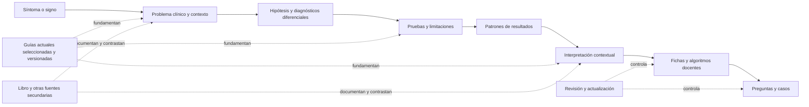

# 03 · Búsqueda, conocimiento clínico y consulta rápida

> Alcance actualizado: este documento describe el producto completo. La primera implementación es el [buscador PWA estático](14_Plan_PWA_estatica.md), sin backend ni base de datos. Para esa entrega prevalecen los documentos 14-16; se conservan aquí las especificaciones compatibles y la evolución posterior.

**Estado:** especificación v1.1, 25 de octubre de 2026, ajustada a las [decisiones confirmadas](13_Decisiones_confirmadas.md). Complementa el modelo de datos y el plan de aprendizaje. Prioriza búsqueda y consulta documental personal en España para distintos perfiles sanitarios, con adultos y pediatría y contenido clínico español/inglés desde el piloto. No contiene recomendaciones clínicas nuevas ni convierte automáticamente el libro en una herramienta de diagnóstico validada.

## 1. Qué debe resolver

El usuario debe poder llegar desde una palabra, un síntoma, una prueba o un problema a una respuesta breve y verificable, abrir su explicación y consultar la fuente exacta. Las guías actuales seleccionadas y revisadas serán la estructura principal; el libro conserva su biblioteca y mapa de páginas como fuente secundaria. El mismo conocimiento revisado debe alimentar fichas, preguntas, casos y algoritmos; las respuestas no deben proceder de copias divergentes del texto.

Se distinguen tres experiencias:

| Experiencia | Pregunta del usuario | Respuesta del sistema |
| --- | --- | --- |
| Biblioteca | «¿Dónde se explica este tema?» | Capítulos, páginas, tablas y figuras con su documento original. |
| Consulta temática | «¿Qué conceptos, pruebas y situaciones se relacionan con este síntoma?» | Enlaces editoriales contextualizados, con explicación, alcance, fecha y fuente. |
| Aprendizaje | «Quiero practicar qué información es relevante y por qué» | Preguntas, casos y recorridos docentes que fijan revisiones concretas del conocimiento. |

La consulta temática inicial devuelve conocimiento publicado para la audiencia personal autorizada, no una probabilidad personalizada de enfermedad. Las sesiones de casos utilizan casos ficticios o adaptaciones docentes revisadas, sin datos reales. Se ha elegido estudiar en el futuro una posible orientación individualizada como alcance separado; no se implementa ahora ni se recogen datos de pacientes. El alta de otros usuarios con aprobación y la docencia de grupos corresponden a fases posteriores.

## 2. Estructura del conocimiento



Cada flecha clínica es una afirmación identificada y revisada, con sujeto, predicado, objeto, contexto y citas. No representa causalidad automática ni una relación de certeza. «Relacionado» y «equivalente» son relaciones distintas.

`clinical_topics` y sus vínculos con objetivos constituyen la navegación principal por problemas y competencias. `book_sections`, capítulos y páginas mantienen la clasificación documental secundaria sin eliminar los mapas originales. Un tema puede integrar varias guías y capítulos; una ficha puede participar en varios temas. La clasificación docente no cambia automáticamente cuando cambia el índice de una edición del libro.

### Tipos de ficha

| Tipo | Información principal | Enlaces de salida |
| --- | --- | --- |
| Problema/síntoma | Definición, forma de describirlo, población, preguntas docentes y manifestaciones asociadas | Enfermedades, pruebas, casos y recorridos temáticos. |
| Enfermedad/síndrome | Alcance, presentación, conceptos clave, diagnóstico diferencial, limitaciones y fuentes | Hallazgos, pruebas, algoritmos, capítulos y actividades. |
| Prueba | Qué observa, método, muestra, preparación/preanalítica, tipo de resultado, límites y contexto | Patrones, intervalos, umbrales, enfermedades y ejemplos docentes. |
| Patrón de resultado | Resultado numérico, nominal, ordinal o narrativo; unidad y contexto | Interpretaciones publicadas, explicaciones alternativas y fuentes. |
| Algoritmo | Objetivo, población, entrada, ramas, salidas, limitaciones y versión | Fichas y citas por nodo, práctica guiada y vista del original. |
| Capítulo/fuente | Documento, edición, páginas reales, secciones y estado de transcripción | Texto, PDF, figuras, conceptos y actividades vinculadas. |

Las fichas breves son una capa editorial de autoría humana, sustentada principalmente en guías actuales revisadas: no se extraen como si fueran ya resúmenes clínicamente aprobados. El piloto prioriza soporte vital, problemas cardiorrespiratorios y pruebas básicas, diferenciando adultos y pediatría. Su contenido clínico tiene versiones español/inglés revisadas. El inventario íntegro del libro se conserva para el propietario bajo sus restricciones; no se incorpora automáticamente al contenido exportable o público.

## 3. Desde las fuentes hasta conocimiento utilizable

### 3.0. Selección y derechos de las fuentes

1. Seleccionar guías relevantes para el contexto español y para los temas adultos/pediátricos del piloto. Registrar emisor, edición/versión, población, contexto de aplicación, fecha de consulta, URL persistente y condiciones de uso. Esta especificación no equivale a haber seleccionado ni validado un conjunto concreto de guías.
2. Registrar cada versión como fuente distinta y relacionar sus sustituciones. Extraer las afirmaciones que sustentarán cada ficha mediante autoría y revisión humanas; la fecha más reciente no decide por sí sola una discrepancia.
3. Distinguir texto original del equipo, cita, reproducción, adaptación y traducción, con evaluación de usos por fragmento/activo. Las fuentes pueden seguir enlazadas aunque su contenido no se pueda copiar en un paquete.
4. Mantener aparte la biblioteca/transcripción privada del libro y la base de fichas clínicas originales. Cambiar PDF a Markdown, filas de base de datos o grafo no evita el copyright ni acredita distribución; una cita tampoco autoriza una adaptación completa. Los controles y el marco aplicable se detallan en [04_Ingesta_y_gobierno_del_contenido.md](04_Ingesta_y_gobierno_del_contenido.md).

No se realiza una nueva extracción en esta actualización del plan. La futura ingesta validará los archivos existentes antes de cargar o transformar contenido; la posibilidad técnica de indexar no decide sus derechos.

### 3.1. Inventario y preservación

1. Leer `Libro dividido/manifiesto.json`, el índice y los hashes existentes; comprobar que los documentos disponibles corresponden a ese inventario.
2. Registrar original, 25 PDF derivados y sus mapas de páginas. La referencia humana principal es **página real del original**, desde 1; se muestra también la página local del PDF dividido y la etiqueta impresa si se conoce.
3. Ingerir los Markdown como transcripción auxiliar con referencia a su extracción. No considerar el Markdown una fuente independiente del libro.
4. Catalogar figuras, tablas y algoritmos como recursos visuales con procedencia, sin copiarlos de nuevo ni atribuirles permiso de distribución. La extracción textual no sustituye un diagrama ni demuestra que sus flechas se hayan interpretado correctamente.

### 3.2. Control de extracción y OCR

Clasificar cada página como capa de texto, OCR o mezcla. Mantener texto crudo, normalización para búsqueda y correcciones editoriales separadas. El inventario actual señala 32 páginas con OCR en Markdown; esa señal sólo identifica un trabajo pendiente, no valida el reconocimiento.

Priorizar cotejo visual de tablas, desigualdades, negaciones, números, unidades, subíndices, superíndices, notas al pie, saltos de columna y flechas. Los fragmentos que alimenten explicaciones, respuestas correctas o condiciones de algoritmos deben tener revisión específica. Un OCR con confianza alta no sustituye esta revisión.

La biblioteca privada del propietario puede mostrar «texto extraído pendiente de cotejo» junto a su PDF autorizado. Una ficha de consulta o actividad docente publicada exige pasar los controles editoriales y de uso del contenido. Las incidencias se anclan a página, región y versión de extracción para que una nueva importación no pierda las correcciones.

### 3.3. Segmentación y extracción de candidatos

Segmentar por estructura editorial: capítulo → epígrafe → párrafo, tabla o figura. Propuesta inicial para búsqueda: fragmentos de unas 150–400 palabras, ajustados a los límites de sección; evitar cortar listas, tablas y explicaciones a mitad. Es un parámetro a medir, no un requisito de longitud de las fichas.

Cada fragmento conserva `revision_public_id`, idioma, capítulo, páginas y localizadores. Las tablas complejas conservan su recurso visual y una representación estructurada revisada si se desea explotarlas. Un algoritmo escaneado conserva imagen y se transcribe a grafo mediante revisión de cada rama; no se reconstruye su lógica sólo a partir del orden del texto OCR.

Se utilizan herramientas deterministas para segmentación, OCR y detección de candidatos según reglas explícitas, con herramienta y versión registradas. La selección de términos, entidades, relaciones y preguntas es humana; **no se incorpora IA a las primeras versiones**. Todo candidato editorial entra como `draft`; no se completan números, dosis, unidades, respuestas o referencias ausentes. Tampoco se envían capítulos o consultas a proveedores de IA.

### 3.4. Normalización clínica y revisión actual

Unificar variantes ortográficas, sinónimos y acrónimos mediante términos revisados, manteniendo el original. Separar síntomas de signos, pruebas de resultados, intervalos de umbrales y asociaciones de reglas.

El libro se identifica como edición de 2018 según la fuente del proyecto; su contenido no se etiqueta automáticamente como vigente en 2026. Cada ficha registra guías principales, fuentes secundarias, alcance español revisado, población adulta/pediátrica, discrepancias, responsable y fecha. La ficha parte de las fuentes actuales seleccionadas, en vez de actualizar obligatoriamente cada párrafo del libro. El libro sigue visible para consulta privada como fuente histórica; las revisiones de fichas no reescriben lo que decía el original.

Un desacuerdo entre fuentes exige una nota editorial y un alcance explícito. El sistema no resuelve discrepancias por votación, fecha más reciente o número de documentos. Si falta sustento suficiente, la relación se mantiene fuera de la consulta rápida y de los ejercicios publicados.

El equipo revisor aún debe organizarse. Hasta disponer de revisión clínica independiente para los elementos críticos y revisión clínica lingüística español/inglés, las fichas afectadas permanecen como borradores. La consulta privada a los documentos y su búsqueda no se presentan como aprobación clínica del corpus.

## 4. Motor de búsqueda del MVP

### 4.1. Componentes

- `SearchService`: orquesta términos, filtros y permisos; no contiene SQL en los componentes Livewire.
- `ConceptResolver`: resuelve denominaciones y acrónimos exactos a identidades; devuelve alternativas cuando hay ambigüedad.
- `SearchIndexProjector`: genera `search_documents` por revisión, idioma y fragmento. Se ejecuta en cola después de confirmar una publicación.
- `PrivateSourceIndexProjector`: genera `source_search_documents` sólo para las fuentes privadas y usos permitidos. Se consulta por una ruta de biblioteca separada; no mezcla transcripciones sin cotejar con fichas revisadas.
- `MariaDbSearchRepository`: FULLTEXT, prefijos controlados y consultas relacionales.
- `SqliteSearchRepository`: implementación de pruebas con capacidades explícitas; no pretende simular relevancia de producción.
- `CitationResolver`: devuelve páginas originales, páginas derivadas, figura/tabla y URL autorizada.
- `PublicationGuard`: vuelve a comprobar que cada revisión candidata sigue publicada y disponible antes de devolverla.

El MVP usa MariaDB relacional y FULLTEXT con las versiones estrictas del stack indicado. Sin IA, embeddings ni generación de respuestas. Un buscador especializado posterior requeriría una decisión nueva y mediciones que justifiquen su coste; esta documentación no autoriza cambiar dependencias o versiones.

### 4.2. Proceso de una consulta

1. Identificar al propietario, organización personal, idioma, alcance de contenido y filtros permitidos. Validar longitud de consulta y limitar frecuencia. Las mismas Policies deberán probarse de nuevo antes de abrir altas aprobadas en una fase posterior.
2. Conservar la consulta original para mostrarla; crear una forma normalizada para comparar términos. Normalización conservadora: Unicode coherente, espacios, case folding apropiado y variante sin diacríticos como campo auxiliar. No borrar signos que cambien una unidad o desigualdad.
3. Resolver coincidencia exacta de título, código, sinónimo y acrónimo. Un acrónimo con varios significados muestra opciones y contexto; no se expande a un único diagnóstico de forma silenciosa.
4. En `reviewed`, buscar candidatos FULLTEXT en el idioma elegido y revisiones publicadas con aprobación clínica para el alcance. En `library`, usar el índice privado de fuentes con permiso de acceso/uso y etiquetas de extracción; nunca promover un resultado privado al catálogo revisado por coincidencia de texto. Expandir sólo sinónimos aprobados; preservar la consulta y señalar las expansiones.
5. Completar con consulta relacional para conceptos vinculados: no mezclar el resultado de una relación con una coincidencia textual como si fueran la misma evidencia.
6. Deduplicar por ítem en fichas, o por fuente/localizador en biblioteca, conservando el fragmento y sus localizadores. Aplicar filtros principales de tipo, tema/problema, competencia, población, idioma, alcance revisado y descarga. Sección/capítulo son filtros secundarios del libro. Si se consultan ambos alcances, se muestran bloques diferenciados.
7. Ordenar por relevancia de recuperación y presentar hasta 20 resultados por página con cursor estable. La puntuación de búsqueda nunca se presenta como probabilidad diagnóstica.
8. Registrar métricas agregadas, incluyendo búsquedas sin resultado; evitar conservar texto libre identificable. La telemetría detallada es optativa y tiene retención definida.

### 4.3. Límites reales de FULLTEXT

En InnoDB, los tokens cortos pueden quedar fuera del índice y existen palabras excluidas; el comportamiento depende de configuración y requiere reconstrucción del índice si se cambia. Tampoco se debe asumir tolerancia a erratas, sinonimia ni lematización española, árabe o darija por utilizar FULLTEXT. [MariaDB: Full-Text Index Overview](https://mariadb.com/docs/server/ha-and-performance/optimization-and-tuning/optimization-and-indexes/full-text-indexes/full-text-index-overview).

Por ello:

- Acrónimos, términos cortos, códigos y unidades se resuelven mediante `content_terms` y equivalencia exacta/prefijo indexado, incluso si no aparecen en FULLTEXT.
- El prefijo se aplica sólo tras un mínimo configurable de caracteres y con límites de candidatos; no usar `LIKE '%consulta%'` sobre todo el corpus en cada pulsación.
- La lista clínica de términos y sinónimos se revisa. No depender de una stoplist genérica para palabras con posible importancia médica.
- Las palabras con posibles errores de escritura ofrecen sugerencias de un diccionario acotado; no se transforma silenciosamente una consulta en otro concepto.
- Español e inglés tienen baterías de consultas y sinónimos revisados desde el piloto, sin confundir siglas de ambos idiomas. Árabe y darija se reservan para una ampliación con batería propia; las normalizaciones y transliteraciones requieren revisión y no alteran el texto fuente.
- El orden por relevancia se estabiliza con identidad y revisión como desempate; las puntuaciones de FULLTEXT no son comparables entre idiomas ni con los pesos relacionales.

Laravel ofrece `whereFullText` para motores compatibles; se usará el adaptador de base y enlaces de parámetros. El orden de resultados y filtros se verificará contra la versión instalada, sin copiar funcionalidades de otra versión del framework. [API Laravel 12: Query Builder](https://api.laravel.com/docs/12.x/Illuminate/Database/Query/Builder.html).

### 4.4. Consulta de ejemplo

Esquema simplificado para candidatos textuales; las políticas y el filtro final de publicación se aplican en el servicio:

```sql
SELECT sd.id, sd.revision_id, r.content_item_id,
       MATCH(sd.title, sd.aliases, sd.body)
           AGAINST (:query_score IN NATURAL LANGUAGE MODE) AS text_score
FROM search_documents AS sd
JOIN content_revisions AS r ON r.id = sd.revision_id
JOIN content_items AS i
  ON i.id = r.content_item_id AND i.published_revision_id = r.id
WHERE sd.locale = :locale
  AND i.availability = 'active'
  AND r.clinical_review_status = 'valid_for_scope'
  AND MATCH(sd.title, sd.aliases, sd.body)
      AGAINST (:query_filter IN NATURAL LANGUAGE MODE)
ORDER BY text_score DESC, sd.id ASC
LIMIT 80;
```

Se enlazan dos parámetros con el mismo valor; no se interpolan consultas del usuario. El límite de 80 es candidato para evaluación. Los términos exactos se obtienen en otra consulta indexada y se fusionan en el servicio; evitar un gran `OR` entre columnas y subconsultas que impida optimizar los índices.

La consulta de ejemplo corresponde a `reviewed`, con filtro adicional de idioma clínicamente aprobado y audiencia/uso aplicado por el servicio. `library` usa otra proyección y verifica las Policies de la fuente antes de generar cualquier extracto. La pantalla muestra el estado de cada resultado; el filtro por defecto de consulta rápida usa `reviewed`. Si aún no hay fichas aprobadas no se rellena ese espacio con transcripciones presentadas como revisadas: se ofrece abrir la biblioteca privada con su estado real.

## 5. Relevancia, presentación y filtros

Orden inicial de preferencia, pendiente de evaluación con consultas reales:

1. Identidad exacta o código verificado.
2. Título o sinónimo exacto en el idioma solicitado.
3. Título por prefijo y términos clínicos revisados.
4. Coincidencia de texto con ajuste por tipo solicitado y contexto editorial.
5. Contenido relacionado, en un bloque distinto con una explicación de la relación.

No se eleva una ficha sólo por recibir más clics ni se oculta una discrepancia por resultar incómoda. La criticidad clínica no se deduce de la puntuación textual. Si se destaca contenido de seguridad, la marca y su posición pertenecen a una decisión editorial documentada.

Cada resultado contiene título, tipo, extracto autorizado con término resaltado, fuente/versión, localizador, idioma, población, fecha/estado de revisión y disponibilidad offline. Una cita web usa sección y URL; una cita PDF muestra página real y local si está registrada. Ofrece «Abrir ficha», «Ver fuente» y, si existe, «Practicar»; la página del libro sólo se abre para su propietario con permiso. Una figura autorizada abre su original con pie y contexto, no un recorte sin identificación.

Filtros iniciales: tipo de recurso, tema/problema, competencia, adultos/pediatría según material, idioma español/inglés, fuente/versión, revisado/pendiente y descargado. La biblioteca añade sección y capítulo. Los filtros activos se muestran como chips accesibles y se pueden retirar individualmente. El itinerario por perfil sanitario adapta profundidad y objetivos, sin alterar hechos clínicos ni otorgar competencia por el rol técnico. No se solicitan datos reales de pacientes para una búsqueda bibliográfica.

## 6. Pruebas y resultados: cómo evitar una base engañosa

La pregunta «¿qué respuestas da esta prueba en cada enfermedad?» se modela como **patrones de resultados asociados a hipótesis en contextos concretos**, con limitaciones y explicaciones alternativas.

| Concepto | Persistencia | Consecuencia en la interfaz |
| --- | --- | --- |
| Prueba | Identidad y revisión de método, muestra, escala y limitaciones | Mostrar qué prueba concreta se está consultando. |
| Resultado | Patrón numérico, cualitativo o narrativo con unidad y comparador | No convertir una categoría a número ni usar cero para «no conocido». |
| Intervalo de referencia | Población, método/laboratorio y límites | Mostrar como referencia contextual, separado de la decisión. |
| Umbral de decisión | Objetivo, contexto, método, criterio y evidencia | Explicar propósito y límites; no aplicarlo fuera de alcance. |
| Interpretación | Afirmación revisada que apoya, debilita o no discrimina entre hipótesis | Mostrar incertidumbre y alternativas; no «confirma siempre». |
| Rendimiento diagnóstico | Sensibilidad, especificidad o LR con estudio, población, umbral e intervalo de incertidumbre cuando exista | Usarlo sólo donde su validación permita y con su fuente visible. |

La representación distingue resultados ausentes, pendientes, no realizados, no interpretables y negativos. También separa resultado de análisis, síntoma referido y signo explorado. Una prueba puede tener distintos componentes y métodos, y un patrón puede asociarse a varias enfermedades.

El contenido no completa una matriz densa prueba × enfermedad inventando celdas. `Sin relación registrada` significa que el corpus no contiene una afirmación revisada, no que la enfermedad excluya ese resultado.

## 7. Diagnóstico diferencial y probabilidad

En el MVP, el diferencial es un mapa docente de hipótesis relacionadas y elementos discriminantes; su orden es editorial o alfabético según el modo, con una explicación visible. No se producen porcentajes de diagnóstico a partir de coincidencias de síntomas.

Un módulo probabilístico posterior sólo puede habilitarse por herramienta validada y población definida. Requiere documentar probabilidad previa o método para estimarla, rendimiento de la prueba, contexto, incertidumbre y validación de implementación. No extrapolar una LR a un método, umbral o población diferentes sin revisión.

Para docencia matemática puede explicarse la relación `odds posteriores = odds previas × LR`; exige distinguir odds de probabilidad. [AHRQ: Methods Guide for Medical Test Reviews, apéndice de métricas](https://effectivehealthcare.ahrq.gov/sites/default/files/pdf/methods-guidance-tests_overview-2012.pdf). El software no fabrica una LR a partir de «frecuente», «compatible» o «característico». Tampoco multiplica varias LR como si los hallazgos fueran independientes cuando esa independencia no esté justificada. Sensibilidad y especificidad no son valores predictivos universales.

Un instrumento validado se incorpora como recurso versionado con criterios completos, restricciones, población, fuentes, unidades, pruebas de límites y revisión humana. Datos faltantes generan «no calculable/no aplicable» según el instrumento, no valores asumidos. Los cambios en la implementación requieren revisión y nueva versión, aunque el texto visible no cambie.

## 8. Contratos con preguntas, casos y algoritmos

- Una actividad publicada referencia `revision_public_id` de la afirmación o ficha que sustenta su explicación. La cita se puede abrir desde la corrección.
- El banco de preguntas puede seleccionar por concepto, objetivo, tema, población y estado de revisión; sección es un filtro documental secundario. La selección no cambia qué respuesta era correcta en un intento ya iniciado.
- Un caso puede solicitar una prueba y mostrar resultados sintéticos compatibles con su guion. No se generan resultados clínicos aleatorios a partir de medias inventadas ni se mezclan métodos sin control.
- Los algoritmos tienen versión, alcance, nodos tipados y ramas exhaustivas para los valores admitidos. «Desconocido» es un estado distinto de «no».
- El motor interpreta una DSL limitada de condiciones. Ninguna fórmula libre extraída de un PDF se ejecuta como código.
- La retirada de una afirmación marca como afectadas sus actividades y evita su uso en sesiones nuevas hasta revisión. Los resultados históricos conservan contexto y corrección originales.

Las fichas y actividades se redactan por personas y se revisan. La decisión vigente excluye IA en las primeras versiones; no se configura proveedor, chatbot ni generador automático de tests. Una futura propuesta requeriría una nueva decisión explícita y no condiciona la arquitectura actual.

## 9. Búsqueda sin conexión

La PWA descarga paquetes explícitos de **lectura y tests formativos** por tema/problema y lengua, con tamaño visible, fecha, versión, checksum, fuentes y usos autorizados. Casos interactivos y recorridos de algoritmos offline se posponen; las evaluaciones con reglas de examen permanecen en línea. Un algoritmo puede figurar como material de lectura autorizado sin habilitar su motor interactivo sin conexión. No se descarga el libro completo por defecto ni se considera que el acceso personal a un PDF permita incluirlo en todo paquete.

El contenido ya descargado se consulta con una proyección local pequeña en IndexedDB, creada a partir de `release_items` y un índice de términos; no se intenta ejecutar FULLTEXT de MariaDB en el navegador. El manifiesto enumera capacidades y derechos por componente; un permiso de lectura online no basta para exportar texto, imágenes o traducciones a un paquete offline.

Contrato local mínimo: ítems y revisiones públicas, títulos/resúmenes autorizados, términos normalizados, relaciones revisadas, localizadores, recursos descargados y manifiesto. La búsqueda local prioriza exactos/prefijos y filtros; su capacidad y diferencias con la búsqueda en línea se indican claramente. La tolerancia a errores sólo se añade si se mide tamaño y rendimiento.

La pantalla sin conexión muestra la última comprobación de vigencia y el estado del paquete. Una actualización trae manifiesto, sustituciones y retiradas mediante tombstones. El cliente no puede conocer una retirada nueva estando desconectado: la interfaz debe comunicar esa limitación y aplicar la política de caducidad acordada para consulta rápida. No se promete revocación instantánea de archivos descargados.

Los borradores editoriales, claves, resultados de otros usuarios y respuestas ocultas de evaluaciones no se incluyen en el paquete. Los tests formativos descargados pueden contener la corrección local porque no se presentan como evaluación supervisada; la política y la sincronización se describen en los documentos 05 y 09.

## 10. API, servicios y caché

Rutas conceptuales bajo `/api/v1`, protegidas por Sanctum y políticas; la interfaz Livewire puede usar los mismos servicios sin una llamada HTTP interna:

| Operación | Entrada | Salida mínima |
| --- | --- | --- |
| `GET /search` | `q`, `locale`, `scope`, filtros, cursor | Ítems con `item_public_id`, `revision_public_id`, tipo, extracto, estado, citas y cursor. |
| `GET /items/{item_public_id}` | Identidad pública y locale | Revisión publicada, ficha, alcance, relaciones y fuente. |
| `GET /items/{item_public_id}/interpretations` | Ítem de tipo prueba, contexto temático y filtros | Patrones y afirmaciones con contexto; sin emitir diagnóstico individual. |
| `GET /revisions/{revision_public_id}/citations` | Revisión autorizada | Localizadores, páginas original/local, URL autorizada. |
| `GET /sources/{source_public_id}/pages/{page_no}` | Página real, permiso | Metadatos y enlace autorizado; no exponer rutas de almacenamiento. |
| `GET /offline-packs/{pack_public_id}/manifest` | Versión local y locale | Versión, elementos, checksums, tamaños y retiradas. |

Las respuestas declaran `content_release_public_id`, idioma efectivo y si ha habido fallback. Un fallback de interfaz no supone fallback médico aceptado. El corpus clínico acordado para el piloto debe tener español e inglés aprobados; fuera de él se puede ofrecer un original con su idioma indicado, sin computarlo como cobertura bilingüe completada.

La caché de fichas usa revisión inmutable e idioma. La de resultados añade versión del índice, release, filtros, permisos/alcance y organización cuando sea relevante; no reutiliza una respuesta personal entre usuarios. Se publica mediante outbox, con trabajos idempotentes y reconstrucción completa disponible. Una retirada invalida el acceso desde el servidor antes de que termine la reindexación.

La búsqueda no carga PDF ni OCR en tiempo de solicitud. Esos procesos se ejecutan en colas con límites de tamaño, memoria y tiempo. El manifiesto del original se valida antes de importar y se conserva para auditoría.

## 11. Calidad de recuperación y criterios de aceptación

Preparar por hitos un conjunto editorial inicial de al menos 100 consultas representativas antes de validar el buscador: títulos, sinónimos, siglas de 2–3 letras, términos ambiguos, errores comunes, búsquedas por prueba y consultas sin respuesta. Debe cubrir español/inglés, adultos/pediatría y los tres ámbitos del piloto. Su selección requiere revisión clínica y uso piloto, no sólo títulos utilizados para programar el índice. La falta actual de equipo revisor se registra como dependencia pendiente, sin dar por hecha esa evaluación.

Para cada consulta guardar resultados esperados por categoría, conceptos que no deben fusionarse y citas verificables. La ampliación a árabe y darija requiere consultas evaluadas por personas competentes en esos idiomas y en el contenido médico.

Objetivos iniciales, todavía no medidos:

- ≥ 90 % de consultas con concepto exacto conocido lo sitúan entre los tres primeros resultados.
- ≥ 85 % del conjunto de búsqueda temática tiene al menos un resultado editorialmente pertinente entre los cinco primeros.
- Cero resultados retirados mostrados como vigentes y cero filtraciones de material restringido en el conjunto de pruebas.
- Cien por cien de fichas de consulta y actividades publicadas con citas resolubles y revisión requerida.
- Búsqueda caliente p95 de servidor ≤ 300 ms en carga piloto definida; medir latencia total en móviles representativos por separado.

La cantidad futura de usuarios activos es desconocida. Se mide primero el uso personal con un corpus y hardware descritos. Cualquier escenario adicional de concurrencia es una prueba sintética de capacidad y no una estimación de usuarios reales. No se contrata alojamiento ni se declara dimensionado hasta resolver esa decisión y medir.

No usar precisión diagnóstica como métrica de relevancia textual. El orden de un resultado correcto en el buscador y la corrección clínica de su afirmación se auditan mediante pruebas distintas.

Pruebas obligatorias: MariaDB real con FULLTEXT y configuración de tokens; filtros y permisos; invalidación de revisiones; extracción de citas; unidades y tipos; resultados desconocidos; conflictos de sincronización; aperturas a la página correcta; búsqueda local; idiomas/RTL y navegación accesible. SQLite cubre la lógica común, pero no acredita comportamiento de FULLTEXT.

## 12. Secuencia de implantación

| Etapa | Entregable | Criterio para avanzar |
| --- | --- | --- |
| Inventario | Fuentes actuales candidatas, derechos, hashes y mapas existentes catalogados | Correspondencia con originales/derivados; sin asumir una licencia por conversión de formato. |
| Biblioteca personal | Índice privado, lectura y búsqueda textual con etiquetas de extracción | Sólo propietario; resultados trazables, aperturas correctas y permisos probados. |
| Piloto clínico | Temas soporte vital, problemas cardiorrespiratorios y pruebas básicas; adultos/pediatría; fichas español/inglés | Guías seleccionadas/versionadas, cobertura acotada, derechos y revisión clínica/lingüística superados; equipo revisor pendiente de organizar. |
| Aprendizaje individual | Tests, casos ficticios/adaptados y algoritmos del piloto unidos a revisiones | Respuestas/recorridos reproducibles, sin IA, citas visibles y retiradas propagadas. |
| Offline inicial | Lectura autorizada, tests formativos y búsqueda local del piloto | Integridad, caducidad, actualización y retiradas probados; casos y motor de algoritmos offline pospuestos. |
| Docencia y apertura posterior | Grupos, tareas y evaluaciones online; registro con aprobación | Revisión de derechos/audiencias y aislamiento; notificaciones de tareas/plazos según función activa. |
| Ampliación | Incorporación gradual del corpus restante | Calidad mantenida y carga editorial sostenible, sin publicar en masa sin revisión. |

La biblioteca documental puede estar completa antes que la base clínica estructurada. Publicar 1.101 páginas no significa haber validado todas sus afirmaciones, algoritmos o posibles preguntas; la cobertura de cada capa se mostrará por separado.

La dedicación es personal y limitada; el avance se organiza por hitos sin fecha cerrada, con consulta y búsqueda primero. Permanecen pendientes la selección concreta de guías, revisores, cobertura del primer lote, alojamiento y medidas reales de rendimiento. El registro de decisiones confirmado es la autoridad sobre alcance, idiomas y funciones; el cuestionario original se conserva como antecedente, no como decisiones aún sin contestar.
