# Preparación y gobierno del contenido

> Alcance actualizado: este documento describe el producto completo. La primera implementación es el [buscador PWA estático](14_Plan_PWA_estatica.md), sin backend ni base de datos. Para esa entrega prevalecen los documentos 14-16; se conservan aquí las especificaciones compatibles y la evolución posterior.

Versión 1.1, según [decisiones confirmadas](13_Decisiones_confirmadas.md). Guías actuales como estructura clínica principal; libro como fuente secundaria restringida. Uso privado del propietario, sin IA y sin equipo de revisión clínica todavía designado.

## 1. Tres capas que deben conservarse

| Capa | Contenido | Tratamiento |
| --- | --- | --- |
| Archivo de origen | PDF íntegro y PDF por secciones | Preservar bytes, huellas, edición, páginas y permisos de uso |
| Transcripción | Markdown y resultados OCR | Mantener trazabilidad por página; revisar errores sin alterar el original |
| Conocimiento publicado | Fichas, relaciones, preguntas, casos y algoritmos | Autoría explícita, revisión, citas y versión inmutable |

Importar un párrafo no valida clínicamente sus afirmaciones. La edición original es de 2018 y contiene recomendaciones de años anteriores. Se conserva el inventario existente; una importación adicional de texto o imágenes depende de los usos comprobados de cada fuente. La base estructurada se redactará desde preguntas clínicas y guías actuales, con el libro como referencia secundaria, no mediante una sustitución mecánica de su PDF por registros.

## 2. Inventario de entrada y conservación

Entradas locales documentales: `Libro dividido/manifiesto.json`, los `referencias.json`, los PDF y los `contenido.md`. El importador de inventario calculará SHA-256, tamaño, MIME y número de páginas, comprobará los 25 rangos sin huecos y registrará una ejecución con estado y resultados. Registrar metadatos y páginas no obliga a cargar el texto completo en la base clínica ni a incluirlo en paquetes de la aplicación.

Entradas clínicas principales: guías actuales identificadas por versión, ámbito España, población adulta/pediátrica y usos permitidos. Seleccionar fuentes y autores/revisores del sublote antes de transformar contenido. Español e inglés tendrán revisión propia; árabe y darija se incorporarán más adelante. Acceso público a una guía no equivale a licencia libre.

El hash del PDF original existente es `8840ec68ac1d05cb9d90639b584ad1a1a2fff2268ca5cb105e385f8c9eb26c00`. Se comprobará al iniciar la ingesta, sin considerarlo un valor universal para otras ediciones.

Para cada página guardar: ordinal real en el original, ordinal en PDF de sección, etiqueta impresa como texto opcional, método de extracción, idioma detectado/revisado, localización del archivo y huella. No aplicar un desplazamiento global entre numeración impresa y real: la composición de este PDF no permite esa suposición.

La numeración impresa `e1`, romana o ausente debe mantenerse como etiqueta, sin convertirla en ordinal de extracción. Una cita puede cubrir varias páginas y un rectángulo opcional, siempre acompañado de la referencia a la página completa.

## 3. Flujo de importación idempotente

```mermaid
flowchart LR
 A[Inventario y usos de las fuentes] --> B[Registrar documentos y páginas]
 B --> C[Preparar borradores autorizados]
 C --> D[Segmentar capítulos y bloques]
 D --> E[Identificar conceptos y relaciones candidatas]
 E --> F[Cotejo documental]
 F --> G[Revisión clínica y traducción]
 G --> H[Publicar revisión y dependencias]
 H --> I[Reindexar y crear paquete]
```



Cada etapa produce un informe, no modifica la etapa de origen. `import_batches` registra el lote, versión de pipeline, hash de entrada, totales y errores; `extraction_runs` registra la herramienta y los parámetros de cada extracción. La clave de deduplicación de una página combina documento/edición, ordinal y huella. Repetir el mismo lote no duplica capítulos ni material. Si cambia la extracción, crear una nueva versión de transcripción. No habrá generación con IA dentro de este flujo en las primeras versiones: las propuestas de entidades, preguntas y relaciones se elaborarán mediante edición y herramientas deterministas.

Los procesos extensos van a colas con lotes, reintentos limitados y puntos de reanudación. Un lote parcial queda visible para editores como incompleto y no se publica por el éxito de sus primeras páginas.

## 4. Segmentación y tipos de bloque

Tipos iniciales: párrafo, encabezado, lista, tabla, figura, algoritmo, fórmula, nota y referencia. Conservar orden de lectura y, cuando sea posible, posición en página. El texto plano actual puede mezclar columnas; antes de convertirlo a ficha hay que cotejarlo.

No deducir títulos de capítulos buscando cualquier aparición de «capítulo N»: las remisiones internas causan falsos positivos. Utilizar inventario, encabezados, continuidad y revisión de límites. Confirmar los 198 inicios antes de cargar objetivos docentes.

Las tablas se almacenan como datos estructurados únicamente cuando se han validado filas, columnas, encabezados, unidades y notas al pie. La imagen o página original permanece asociada. Si una tabla no se puede estructurar con fidelidad, publicar una figura accesible y su descripción revisada en lugar de inventar celdas.

## 5. OCR y control de calidad

Las 32 páginas OCR están identificadas en el manifiesto. El estado inicial de su texto será `unverified`. Si el motor no proporciona confianza, guardar `null`, no asignar un porcentaje inventado.

| Elemento | Control antes de usarlo en derivados |
| --- | --- |
| Cifras, decimales y signos | Comparación con imagen a resolución legible; atención a coma/punto y menor/mayor |
| Dosis, unidad, vía y frecuencia | Cotejo independiente de todos los componentes y de su contexto |
| Tabla | Cada celda, cabeceras, población y notas al pie |
| Algoritmo | Cada nodo, flecha, condición, salida y excepción |
| Dos columnas | Reconstrucción y verificación del orden de lectura |
| Bibliografía | Identificador, título, año y correspondencia de la cita |
| Traducción | Sentido, negación, abreviaturas, números, unidades y dirección del texto |

La revisión de extracción y la revisión clínica son estados separados. Un texto puede ser fiel al libro y haber quedado desactualizado; también puede describir una recomendación vigente pero haberse transcrito mal.

## 6. Transformación a fichas

Una ficha nace con un propósito: síntoma, enfermedad, prueba, procedimiento, intervención o concepto. El editor redacta contenido propio con afirmaciones trazables a fuentes actuales y contexto, usando el libro secundariamente. La organización clínica no replica necesariamente el orden del libro. Relacionar conceptos de forma explícita; no convertir toda coaparición en una relación causal.

Ejemplo de plantilla editorial de prueba, sin rellenar datos clínicos:

```text
Identidad y sinónimos:
Pregunta clínica que ayuda a responder:
Población y ámbito:
Muestra, método y momento:
Preparación y limitaciones preanalíticas:
Unidad y rangos de referencia según contexto:
Umbrales de decisión y evidencia específica, si existen:
Interpretaciones posibles, falsos positivos y falsos negativos:
Pruebas relacionadas y alternativas:
Fuentes, páginas y fecha de revisión:
```

Si faltan sensibilidad, especificidad, cocientes de probabilidad o condiciones de aplicación, registrar «no documentado», sin estimarlos a partir de una frase descriptiva. Las unidades y rangos locales se validan con el laboratorio del ámbito de uso.

## 7. Vigencia y fuentes adicionales

Mantener una vista «Libro, edición 2018» separada de la síntesis «Revisado para el ámbito X, fecha Y». Una revisión actualizada no debe reescribir lo que decía el libro; debe mostrar la nueva evidencia y registrar el motivo del cambio.

Como ejemplo de la necesidad de actualización, el ERC dispone de guías de reanimación de 2025 posteriores al libro. El plan propone revisarlas en el lote de soporte vital sin asumir que toda recomendación puede copiarse o aplicarse indistintamente a cualquier país. [ERC Guidelines 2025](https://www.erc.edu/science-research/guidelines/guidelines-2025).

Catálogo de fuentes: edición, organismo, tipo, jurisdicción, población, fecha de publicación, fecha de acceso, licencia, URL/DOI y revisiones a las que respalda. En farmacología española se puede estudiar una integración documental con CIMA; su API y nomenclátor no sustituyen el contraste de la indicación y contexto clínico. [Nomenclátor y servicios REST de AEMPS](https://cima.aemps.es/cima/publico/nomenclator.html).

Propuesta de gobernanza: próxima revisión fijada por riesgo del contenido, vigilancia de fuentes prioritarias y revisión extraordinaria por alertas o errores. Esta es una política del proyecto; el manual NICE se usa como referencia de proceso para cambios, correcciones y retirada, sin afirmar que la aplicación tiene su acreditación. [Actualización de recomendaciones NICE](https://www.nice.org.uk/process/pmg20/chapter/updating-guideline-recommendations).

## 8. Estados y publicación

```text
draft -> in_review -> approved -> published -> superseded
              |           |            |
              v           v            v
            draft        draft       withdrawn
```

`content_items` aporta identidad estable; `content_revisions` conserva el contenido y metadatos de cada versión. Un registro publicado no se edita: se genera una revisión nueva. Antes de publicación se exige:

1. Fuente y páginas verificadas; contexto de uso completo.
2. Extracción cotejada para todo dato crítico utilizado.
3. Revisión clínica aprobada por alguien distinto del autor en contenido crítico.
4. Traducción aprobada si la versión que se publica está traducida.
5. Relaciones y dependencias resueltas a revisiones concretas.
6. Pruebas del algoritmo o de la respuesta del ítem superadas.
7. Derechos y audiencia compatibles con la publicación pretendida.

El permiso `content.publish` no permite omitir estos requisitos. La retirada de emergencia puede suspender visibilidad con un motivo y una auditoría; la corrección posterior sigue el circuito normal.

## 9. Correcciones y propagación

Usar un grafo de dependencias: una pregunta depende de una afirmación y su cita; un caso y un algoritmo pueden depender de esa misma afirmación. Al retirar una revisión, localizar sus consumidores, marcar los pendientes, retirarlos de nuevas sesiones cuando corresponda y regenerar los índices y paquetes afectados.

Un intento pasado conserva su revisión y su resultado original, con una anotación si la pregunta fue retirada. Si un examen necesita recalificación, crear una decisión y un resultado recalculado separados; no reescribir silenciosamente la respuesta histórica.

Un paquete descargado puede estar desconectado y no recibir una retirada inmediatamente. Mostrar fecha de paquete y última comprobación; aplicar las reglas de expiración del documento 09. No prometer revocación remota instantánea sin conexión.

## 10. Derechos y distribución

El usuario declara consulta personal, sin autorización de distribución acreditada. El PDF contiene avisos de derechos de la editorial. Registrar por fuente y uso: titular, licencia/autorización o límite aplicable comprobado, evidencia de esa comprobación, audiencia, almacenamiento, traducción, reproducción, adaptación, descarga y distribución. Un estado «desconocido» no equivale a «permitido».

La conversión técnica no elimina derechos sobre el contenido preexistente; una base de datos tampoco los sustituye. La copia privada está sujeta a condiciones y no se presume aplicable sólo por limitar usuarios. Referencia jurídica para esta decisión: [TRLPI, arts. 12, 17, 18, 21 y 31](https://www.boe.es/buscar/act.php?id=BOE-A-1996-8930).

Ruta de contenido acordada:

1. Conservar el PDF y Markdown ya existentes como archivo documental restringido; no modificar ni borrar esas fuentes.
2. Registrar procedencia y localizadores, separados de la base clínica publicable.
3. Crear fichas, relaciones, preguntas y diagramas propios desde fuentes actuales y usos comprobados, con citas. No utilizar una paráfrasis automática página por página como supuesto saneamiento de derechos.
4. Usar imágenes originales propias, recursos con permiso o enlaces a fuentes; recrear la apariencia de una figura protegida no acredita por sí mismo un uso permitido.
5. Exportar o descargar únicamente los registros y activos cuyo uso esté comprobado para esa salida y audiencia. No incluir el texto íntegro del libro por defecto en paquetes, seeds, ejemplos del repositorio ni exportaciones.
6. Antes de abrir el acceso a otras personas, revisar fuentes, adaptaciones y traducciones para ese uso. Las cuentas aprobadas tampoco obtienen automáticamente acceso al libro.

La meta es una base de conocimiento útil con derechos documentados, no prometer «cero copyright». Esta decisión no impide diseñar la base, preparar fixtures sintéticos ni conservar el inventario.

## 11. Responsables y entregables

| Entregable | Responsable propuesto | Evidencia de aceptación |
| --- | --- | --- |
| Inventario importado | Equipo técnico | Informe de integridad y reimportación sin duplicados |
| Transcripción cotejada | Editor documental | Checklist por bloque y autor de revisión |
| Ficha clínica | Editor clínico | Fuentes, contexto y revisión independiente |
| Pregunta/caso | Docente con competencia temática | Objetivo, solución razonada y revisión de sesgos |
| Algoritmo | Editor y revisor clínico | Grafo, fuentes y batería de caminos |
| Traducción | Traductor y revisor del idioma | Estado por revisión y versión fuente |
| Publicación y retirada | Responsable editorial | Auditoría y comprobación de propagación |

Una misma persona puede desempeñar tareas diferentes; el presupuesto y la disponibilidad de revisión independiente condicionan cuántos temas pueden publicarse por lote.

En la versión 1.1 el equipo revisor está pendiente. El propietario puede avanzar en edición, cotejo, estructura, búsqueda y ejemplos ficticios; el contenido clínico pendiente seguirá identificado como tal. No se marcará como revisado un lote por haberse ejecutado su importación o sus pruebas de software. La publicación de cada sublote necesita revisión en español e inglés y en los ámbitos adulto/pediátrico que incluya.
