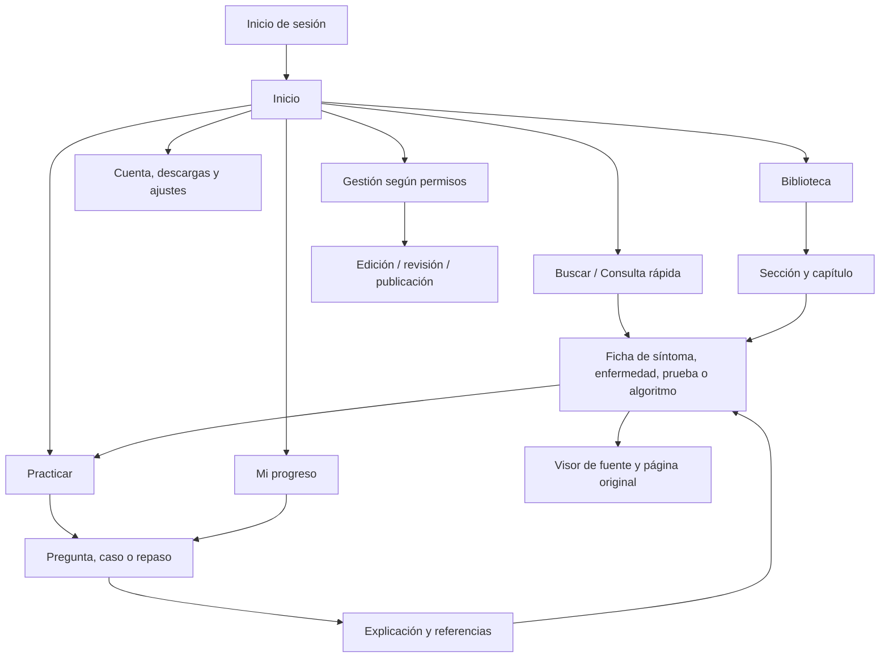
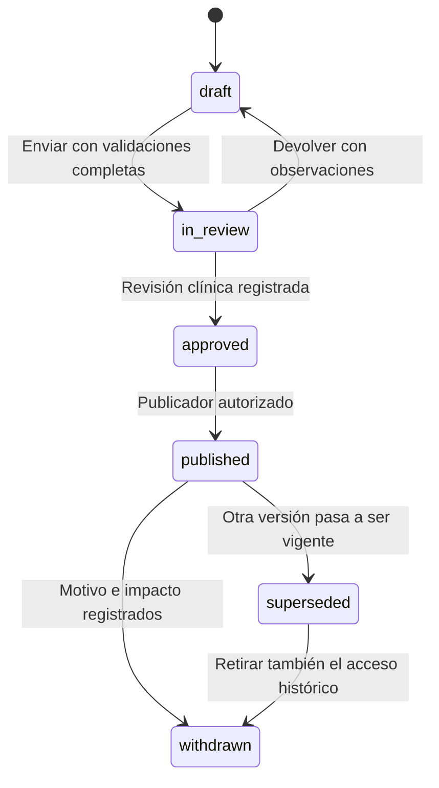

# 07 · Pantallas, navegación y flujos funcionales

> Alcance actualizado: este documento describe el producto completo. La primera implementación es el [buscador PWA estático](14_Plan_PWA_estatica.md), sin backend ni base de datos. Para esa entrega prevalecen los documentos 14-16; se conservan aquí las especificaciones compatibles y la evolución posterior.

**Estado:** v1.1 · catálogo actualizado con decisiones confirmadas; desarrollo por hitos sin fecha cerrada.  
**Fecha:** 25 de octubre de 2026.  
**Relacionados:** [decisiones confirmadas](13_Decisiones_confirmadas.md), [diseño Material 3](06_Diseno_Material_3.md), modelo de datos, aprendizaje, contenidos y arquitectura del plan. Las decisiones confirmadas prevalecen sobre propuestas anteriores.

## 1. Alcance de la experiencia

La aplicación reúne una biblioteca de referencia, una red de contenidos clínicos relacionados y un espacio de aprendizaje. La navegación propuesta permite entrar por un capítulo, un síntoma, una enfermedad, una prueba, un algoritmo o una actividad educativa. Todas esas entradas deben conducir al contenido fuente y a su estado editorial.

La biblioteca clínica se estructurará principalmente por guías actuales, temas, síntomas, pruebas y población. El libro dividido de 2018 queda como referencia secundaria en el archivo personal del propietario, con trazabilidad completa. La interfaz mostrará las cantidades que confirme el inventario importado, no contadores manuales. Una página física del PDF original se denomina aquí **página real original** y su numeración empieza en 1; se diferencia de la numeración impresa del libro y de la página dentro del PDF de sección. Para guías y otras fuentes se empleará el localizador real disponible: sección, tabla, página, versión o URL, sin inventar paginación de libro.

La primera versión será privada para el propietario, multiprofesional y centrada en búsqueda rápida, con adultos y pediatría. El piloto temático parte de soporte vital, síntomas cardiorrespiratorios y pruebas básicas, ajustados a la población. Español e inglés clínicos están incluidos desde el piloto, con estado de revisión independiente. No habrá IA ni datos de pacientes: la simulación usará exclusivamente casos ficticios o adaptados sin datos personales. El proyecto comienza como aprendizaje y consulta documental; cualquier futura orientación individualizada requerirá otra decisión y una fase específica.

Las pantallas clínicas publicadas requieren contenido revisado y relaciones documentadas. El equipo revisor aún debe organizarse: un borrador no se convierte en contenido revisado por importarlo. Hasta disponer de revisión, el propietario podrá consultar el archivo personal con estado documental explícito y trabajar borradores en gestión. La falta de permisos de distribución no se resuelve cambiando PDF por registros de base de datos.

## 2. Perfiles confirmados y espacios

Los seis perfiles siguientes están confirmados. Que exista el rol no implica que su panel deba implementarse o abrirse a terceros desde el primer hito. La docencia de grupos llega después de validar el uso individual. No se trasladan automáticamente perfiles de otros ámbitos incluidos en la descripción del stack.

| Perfil | Espacio principal | Facultades propuestas |
|---|---|---|
| Aprendiz | Aplicación de consulta y aprendizaje | Leer, buscar, descargar lo autorizado, practicar, guardar y ver su progreso |
| Docente | Aplicación y panel docente | Preparar actividades, asignarlas a sus grupos y consultar resultados autorizados |
| Editor clínico | Panel editorial | Estructurar contenidos, relaciones, preguntas, casos y algoritmos en borrador |
| Revisor clínico | Panel de revisión | Revisar exactitud, fuentes, traducciones y cambios; aprobar o devolver según permisos |
| Administrador | Panel de administración | Gestionar cuentas, roles permitidos, configuración y operación del corpus |
| Superadministrador técnico | Panel técnico restringido | Mantenimiento y configuración técnica; no obtiene aprobación clínica automática por ese rol |

Los permisos pueden acumularse. El menú de gestión se construye a partir de permisos efectivos y ámbito, pero cada acción se vuelve a autorizar en el servidor. Ocultar una opción no protege su ruta. Las políticas de publicación deben evitar que alguien apruebe su propio cambio cuando se exija revisión independiente.

El piloto sólo permite la cuenta del propietario. Las altas externas, la muestra pública y los paneles docentes quedan deshabilitados. El registro con aprobación está confirmado como política para una apertura futura; requerirá habilitación explícita y verificación previa de derechos, contenido y operación. No se mostrarán botones de registro público durante el uso privado.

## 3. Mapa de navegación



Inicio, Buscar, Practicar, Biblioteca y Mi progreso son los destinos canónicos de primer nivel, visibles cuando su hito aporte una función utilizable; no habrá accesos vacíos a módulos aún pendientes. Buscar será el acceso inicial propuesto, configurable. Los perfiles de gestión utilizan una entrada adicional en el menú de usuario, sin desplazar estas funciones. En pantallas estrechas con tres a cinco destinos funcionales se usa barra inferior; al crecer el espacio se transforma en rail o drawer conservando su significado. Con menos destinos habrá navegación breve en cabecera. Este patrón sigue la orientación de [Google para navegación adaptable](https://developer.android.com/design/ui/mobile/guides/layout-and-content/layout-and-nav-patterns); los umbrales web son los propuestos en diseño. Las tres alternativas visuales de ese documento mantienen las mismas tareas y rutas y siguen pendientes de elección.

## 4. Contrato común a las pantallas

Las rutas siguientes son nombres funcionales orientativos; `{id}` representa el identificador público opaco ULID de la entidad. Los identificadores numéricos internos no se exponen como contrato de navegación ni de sincronización. Idioma y estrategia final de URL se concretarán en arquitectura.

Cada pantalla debe especificar:

- **Acceso:** permiso, ámbito y estado de publicación, comprobados en servidor.
- **Datos:** versión consultada, paginación y relaciones necesarias; no cargar todos los contenidos del libro para pintar una pantalla.
- **Navegación:** URL directa, volver, persistencia de filtros y restauración de posición.
- **Carga:** esqueleto sin contenido clínico ficticio y anuncio accesible si la operación tarda.
- **Vacío:** explicación de lo que falta y siguiente acción útil.
- **Error:** distinguir validación, red, permisos, inexistencia y retirada editorial; conservar lo ya escrito.
- **Offline:** declarar si funciona con el paquete local o requiere conexión. Ninguna operación se declara sincronizada antes de confirmación del servidor.
- **Accesibilidad:** título de página, encabezados, foco, teclado, nombres de controles y anuncios de cambios.
- **Trazabilidad:** fuente y páginas donde se derive contenido clínico; en preguntas, visible después de responder cuando el modo educativo lo requiera.

Los estados comunes se heredan; la tabla de cada grupo añade sus particularidades. Un contenido retirado no se confunde con un error 404: se muestra el motivo autorizado y, cuando exista, un sustituto.

### Alcance transversal del catálogo

Se conservan las **48 pantallas como catálogo de producto**, no como una primera entrega indivisible. Se implementarán por los hitos de la sección 12, adaptados a dedicación personal de pocas horas semanales. La consulta rápida tiene prioridad sobre la amplitud del catálogo.

- **Sin conexión inicial:** lectura, búsqueda local de paquetes descargados y tests formativos. Las figuras y textos de algoritmos se pueden leer; los recorridos interactivos y los casos por etapas quedan en línea.
- **Evaluación:** práctica personal y simulacros primero; tareas y exámenes evaluables con reglas separadas en la fase docente, siempre en línea.
- **Traducciones:** español e inglés desde el piloto; árabe y ambas escrituras de darija quedan para después. La ausencia de traducción se muestra antes de abrir la actividad.
- **Fuentes:** guías actuales como base y libro como archivo secundario privado. Cada recurso y derivado conserva su política de uso; no se habilita acceso a otro usuario por cambiarlo de formato.
- **Gestión clínica:** los flujos de revisión se implementan cuando sean necesarios, pero no se simula disponibilidad de revisores ni se concede aprobación clínica al administrador técnico.

## 5. Catálogo de pantallas de entrada y consulta

| ID y ruta funcional | Objetivo y funciones | Acceso y datos | Estados particulares |
|---|---|---|---|
| **S01 · Acceso** `/acceso` | Entrar con método local, Google o passkey según configuración; recuperación y ayuda | Piloto: cuenta del propietario; configuración de métodos y sesión | Sin alta pública; política futura de registro con aprobación. Offline: no autenticar por primera vez. Error genérico de credenciales; alternativa accesible a passkey |
| **S02 · Primera configuración** `/bienvenida` | Elegir idioma, objetivo, nivel orientativo, preferencias de lectura y recordatorios opcionales | Usuario autenticado; preferencias | Todos los pasos opcionales salvo los imprescindibles. Se puede volver a Ajustes; no bloquear consulta con un cuestionario largo |
| **S03 · Inicio** `/inicio` | Consulta rápida, continuar lectura/actividad, repaso pendiente, guardados y avisos relevantes | Usuario; historial propio, progreso y corpus visible | Vacío inicial con «Explorar biblioteca» y «Primera práctica». Offline usa estado local identificado; no inventa progreso |
| **S04 · Buscar / Consulta rápida** `/buscar` | Buscar texto o concepto; filtros por tipo, población, tema, fuente, idioma y disponibilidad; recientes y sugerencias | Propietario inicialmente; índice autorizado y sinónimos revisados | Sin resultados ofrece ampliar filtros o consultar fuentes. Adultos/pediatría visibles. Offline limitado al índice descargado. Fallo de sugerencias no impide enviar la búsqueda |
| **S05 · Resultados** `/buscar?q=...` | Lista mixta agrupable por tipo, fragmentos y relación encontrada; ordenar por relevancia documental | Usuario; resultados paginados y filtros | Explicar búsquedas sin coincidencia exacta; no mostrar puntuación técnica como certeza clínica. Conservar posición al volver |
| **S06 · Biblioteca** `/biblioteca` | Guías y fichas, temas, poblaciones e índice alfabético; archivo personal del libro separado; estado de descarga | Propietario inicialmente; jerarquía y permisos por recurso | La fuente sin estructurar abre sólo el documento al que exista acceso autorizado. No simular una ficha clínica donde sólo hay texto extraído |
| **S07 · Sección** `/secciones/{id}` | Índice de capítulos, descripción editorial, PDF de sección, descarga y práctica por ámbito | Usuario; sección y capítulos publicados | Mostrar rangos reales originales y tamaño del paquete. Si descarga parcial, distinguir cada recurso |
| **S08 · Capítulo** `/capitulos/{id}` | Lectura estructurada, índice de epígrafes, tablas/figuras, relaciones, guardar y practicar | Usuario; versión del capítulo y fuentes | OCR pendiente de cotejo identificado. Si una tabla no está estructurada, enlazar su imagen/PDF preservado |
| **S09 · Ficha de síntoma o síndrome** `/sintomas/{id}` | Definición, contenido de evaluación publicado, signos de alarma documentados, entidades/pruebas/algoritmos vinculados | Usuario; relaciones tipadas y revisión | No introducir datos de paciente en V1. Ausencia de algoritmo se indica. Asociaciones documentales no se ordenan como diagnóstico personalizado |
| **S10 · Ficha de enfermedad** `/enfermedades/{id}` | Presentación, hallazgos, diferenciales documentados, pruebas y algoritmos; población y fuentes por bloque | Usuario; versión publicada y relaciones | Mostrar primero la guía actual y distinguir referencias secundarias del libro. No mostrar recomendaciones en borrador |
| **S11 · Ficha de prueba** `/pruebas/{id}` | Qué explora, muestra/método cuando conste, indicaciones documentadas, patrones, interferencias y limitaciones | Usuario; prueba, patrones y asociaciones revisadas | No llamar «normal» a un rango sin contexto; si no existe rango verificable, mostrar «No disponible en esta ficha» |
| **S12 · Matriz prueba–enfermedad** `/pruebas/comparar` | Comparar pocas entidades seleccionadas; patrón descrito, condiciones y fuente por celda | Usuario; relaciones publicadas | Celdas sin datos = «No documentado», nunca «negativo». Tabla accesible, filtro y vista en lista móvil; sin mapa de calor ambiguo |
| **S13 · Catálogo de algoritmos** `/algoritmos` | Filtrar por tema, población si existe y disponibilidad; abrir representación completa o guiada | Usuario; versiones aprobadas para el uso definido | Algoritmo histórico/no revisado permite consulta documental identificada, pero no inicia un recorrido interactivo como si estuviera vigente |
| **S14 · Algoritmo completo** `/algoritmos/{id}` | Diagrama original autorizado o reconstrucción original revisada, leyenda, población, pasos y versión; ampliar y abrir fuente | Usuario; representación documental y, posteriormente, nodos/aristas publicados | Alternativa textual íntegra. Offline sólo lectura descargada. El primer motor ejecutable exige un grafo acíclico; ramas sin destino, ciclos o finales no declarados bloquean su publicación ejecutable. El original privado se conserva íntegro |
| **S15 · Recorrido educativo de algoritmo** `/algoritmos/{id}/recorrer` | Elegir respuestas de un escenario, ver ruta, volver a decisión y reiniciar; fase posterior | Usuario en línea; versión congelada al comenzar, escenario educativo | No disponible offline en el alcance confirmado. «No consta» no equivale a «No». No avanzar por defecto ante dato ausente. Cambio de versión exige otro recorrido conservando historial |
| **S16 · Fuente documental** `/fuentes/{id}` | Abrir guía o archivo autorizado en su localizador; para PDF, página exacta, búsqueda disponible y ampliación | Usuario con permiso de documento; metadatos, política de uso y mapa de páginas si existe | Libro accesible sólo en archivo personal del propietario. Distinguir número del visor, página real e impresa. Si se ignora `#page`, ofrecer selector; para fuente web, mostrar sección/versión y enlace |

### Anatomía de un resultado

```text
[Prueba]  Nombre de la prueba
Fragmento breve donde aparece la coincidencia, sin cortar unidades.
Relacionada con: [concepto] · Sección: [nombre]
Fuente: [guía/versión/fecha] · Población: [contexto] · Revisión: [estado/fecha]
[Abrir ficha]   [Ver fuente]   [Guardar]
```

Los resultados se pueden alcanzar con teclado sin tabular por decenas de acciones secundarias antes del siguiente título. La jerarquía visual debe distinguir «coincide con la búsqueda» de «recomendado para un paciente».

## 6. Catálogo de aprendizaje

| ID y ruta funcional | Objetivo y funciones | Acceso y datos | Estados particulares |
|---|---|---|---|
| **S17 · Practicar** `/practicar` | Elegir test, caso, repaso o actividad asignada según fase; continuar sesión | Aprendiz y perfiles con permiso; actividades y estado propio | Mostrar sólo modos con contenido publicado suficiente. Sin conexión, sólo tests formativos descargados y repaso de ese mismo tipo; no casos, recorridos ni evaluación docente |
| **S18 · Configurar sesión** `/practicar/nueva` | Tema, población, cantidad, dificultad editorial, objetivo y modo tutor/simulacro personal | Usuario; banco elegible, restricciones y preferencias | Evaluación docente separada y en línea en su fase. Si faltan preguntas, informar antes de empezar; no duplicarlas para completar cupo |
| **S19 · Pregunta** `/sesiones/{id}/preguntas/{n}` | Enunciado, medios, opciones y envío explícito; marcar duda y pausar | Propietario o acceso docente autorizado; versión congelada de la pregunta | Seleccionar no envía. En offline guardar respuesta local pendiente cuando el modo lo permita. En examen, el feedback sigue la política definida |
| **S20 · Explicación** `/sesiones/{id}/preguntas/{n}/revision` | Respuesta correcta según versión, razonamiento, distractores, fuente y repaso | Propietario; respuesta y explicación publicadas de esa versión | Si la pregunta se anula después, mostrarlo; no borrar silenciosamente intentos. Sin explicación aprobada, el ítem no entra en modo tutor |
| **S21 · Resultado de sesión** `/sesiones/{id}/resultado` | Aciertos, omitidas, anuladas, tiempo y temas; revisar y planificar repaso | Propietario; cálculos y denominadores explícitos | Pendiente de sincronizar se separa de resultado confirmado. No mostrar «domina urgencias» ni acreditación sin modelo validado |
| **S22 · Catálogo de casos** `/casos` | Casos por tema, población, objetivo y etapa formativa; estado iniciado/completado | Usuario; casos adaptados del libro según derechos y casos nuevos revisados | Diferenciar procedencias; no copiar adaptaciones sin comprobar su uso. Un caso con etapas incompletas no se inicia. Disponible en línea en su fase |
| **S23 · Caso por etapas** `/casos/{id}/sesion/{sid}` | Presentación, hipótesis educativas, elección razonada de pruebas, nueva información y decisiones | Propietario del intento en línea; caso versionado ficticio/adaptado sin datos personales | Sin IA ni resultados generados al vuelo; datos se revelan según reglas revisadas. Pausa conserva estado; cada consecuencia tiene explicación y fuente. Sin uso interactivo offline |
| **S24 · Discusión de caso** `/casos/sesiones/{id}/discusion` | Comparar decisiones, explicar opciones, revisar errores y enlazar capítulos/pruebas/algoritmos | Propietario; recorrido y explicación revisada | Separar «decisión distinta de la prevista» de «error» cuando el caso admita alternativas. No usar resultados de paciente reales |
| **S25 · Repaso** `/repaso` | Cola por fecha, tema y tipo; iniciar, posponer justificadamente y ver origen | Usuario; programación y eventos propios | Cola vacía explica cuándo habrá pendientes; no confundir ausencia con dominio. Reloj/zona horaria y conflictos de sincronización controlados |
| **S26 · Mi progreso** `/progreso` | Tendencia, cobertura, temas practicados, pendientes y sesiones; exportación propia autorizada | Usuario; agregados de su historial | Siempre periodo y denominadores. Datos insuficientes = «Aún no hay datos suficientes», sin predicciones gratuitas |

### Anatomía de la pregunta

```text
Práctica de [tema]                 3 de 10 · [Pausar]
[Enunciado completo]
[Imagen o tabla con alternativa accesible, si existe]

( ) Opción A, texto completo
( ) Opción B, texto completo
( ) Opción C, texto completo
( ) Opción D, texto completo

[Marcar para revisar]                    [Responder]
```

Tras enviar, el foco pasa a una región de feedback con título o se anuncia el resultado sin expulsar al usuario de su posición. Los colores apoyan las etiquetas «Correcta» e «Incorrecta»; no las sustituyen. Las referencias pueden ocultarse antes de responder si revelan la solución y el modo exige evitarlo, pero quedan disponibles en la revisión.

## 7. Pantallas personales y PWA

| ID y ruta funcional | Objetivo y funciones | Acceso y datos | Estados particulares |
|---|---|---|---|
| **S27 · Guardados y notas** `/guardados` | Colecciones, favoritos y notas personales ligadas a versión/ancla | Propietario; referencias propias | Notas no se mezclan con contenido editorial. Cambio de versión avisa si el ancla ya no existe; no reubicar sin indicarlo |
| **S28 · Descargas** `/descargas` | Paquetes de lectura y tests formativos por tema/población; tamaño, versión, actualizar y liberar espacio | Usuario; manifiesto, derechos por recurso y almacenamiento local | No descarga indiscriminada del libro ni de derivados a terceros. PDF sólo si su política lo admite. Espacio insuficiente, interrupción, hash inválido o expulsión de caché tienen mensajes distintos |
| **S29 · Centro de sincronización** `/sincronizacion` | Operaciones pendientes, última comprobación, reintento y conflictos | Usuario; cola local y confirmaciones | No permitir confirmar a mano que algo ya se sincronizó. Un conflicto muestra opciones concretas sin perder la respuesta original |
| **S30 · Notificaciones** `/avisos` | Repaso y cambios relevantes; tareas y plazos al habilitar docencia | Usuario; avisos propios y preferencias por canal, frecuencia y horario | Correo/push optativos según preferencias. Evitar texto sensible en push o pantalla bloqueada; no usar notificaciones para urgencias asistenciales |
| **S31 · Ajustes y cuenta** `/cuenta` | Idioma/escritura, tema, lectura, objetivos, recordatorios, dispositivos y métodos de acceso | Propietario; preferencias y sesiones | Cambio de idioma mantiene contexto; alternativa si falta traducción. Acciones de cuenta sensibles requieren reautenticación según política |
| **S32 · Ayuda y comunicar incidencia** `/ayuda` | Ayuda de búsqueda, uso offline y reporte de erratas con referencia/versionado | Usuario; guías y formulario | Formulario arrastra entidad/versión/página sin copiar notas privadas; evita introducir datos identificativos de pacientes |
| **S33 · Estado de contenido** `/contenido/{id}/estado` | Explicar retirada, sustitución, falta de traducción o incompatibilidad de versión | Usuario con acceso al contexto | Ofrecer contenido sustituto sólo si editorialmente se ha aprobado; no redirigir silenciosamente una cita antigua |

Las descargas son una función explícita, no una promesa de que todo lo visitado estará offline. El usuario ve qué contiene cada paquete autorizado: lectura, imágenes permitidas, índice y tests formativos. El PDF del libro permanece en el archivo personal; no se presupone que toda su transformación en base de datos pueda distribuirse. Casos y recorridos interactivos, evaluaciones docentes y paneles de gestión requieren conexión. El soporte exacto depende del navegador y se verificará en la matriz PWA del plan técnico. Los apuntes y el progreso tendrán exportación propia; QR e iCalendar sólo se activarán si se define un uso concreto.

## 8. Pantallas de docencia y gestión

Se propone Filament para recursos, tablas, formularios, acciones y widgets de estas pantallas. Las vistas de lectura final reutilizan los componentes clínicos para que el editor revise exactamente la presentación que verá el aprendiz. Los nombres de rutas de panel son orientativos.

| ID | Pantalla y funciones | Acceso y controles fundamentales |
|---|---|---|
| **S34** | Panel docente: grupos, actividades pendientes y resumen de cohortes | Docente limitado a sus grupos; métricas agregadas y acceso individual según permisos |
| **S35** | Actividad docente: seleccionar contenidos publicados, versión, fechas y configuración | Docente; previsualizar como aprendiz; impedir asignar contenido no disponible para ese grupo |
| **S36** | Resultados docentes: intentos, distribución de respuestas y temas | Docente autorizado; indicar muestra, anuladas y periodo; evitar clasificaciones públicas por defecto |
| **S37** | Bandeja editorial: borradores, devoluciones, revisiones vencidas y errores de importación | Editor/revisor según ámbito; filtros por tipo y responsable |
| **S38** | Editor de contenido y relaciones: bloques, tablas, pruebas, síntomas, fuentes y versiones | Editor; autoguardado explícito en borrador; validación de referencias y ausencia de edición destructiva de versiones publicadas |
| **S39** | Editor de preguntas: objetivo, enunciado, opciones, respuesta, distractores, explicación y fuente | Editor/docente con permiso; checklist de calidad del ítem y vista móvil |
| **S40** | Editor de casos: etapas, datos revelables, opciones, rutas y discusión | Editor/docente con permiso; simulación de cada ruta y comprobación de etapas inaccesibles |
| **S41** | Editor de algoritmos: nodos, condiciones, ramas, unidades, referencias y representación original | Editor clínico; vista diagrama más formulario/lista accesible; nodos `start`, `information`, `question`, `action`, `reference` y `end`, con condiciones tipadas en `question`. Detectar decisiones sin rama y rechazar ciclos ejecutables en la primera entrega del motor |
| **S42** | Revisión clínica: diferencia entre versiones, fuentes lado a lado, observaciones y decisión | Revisor con competencia/ámbito; separación autor/revisor cuando proceda; registro de aprobación y condiciones |
| **S43** | Revisión lingüística: original y traducción, terminología y estados por idioma | Traductor/editor autorizado y revisor clínico según flujo; traducción no hereda revisión de otro idioma |
| **S44** | Importaciones y trazabilidad: archivos, rangos, OCR, fragmentos y errores | Editor/administrador con permiso; reintentos idempotentes y vista de página real |
| **S45** | Publicaciones y retiradas: versiones, dependencias, motivo y efecto en actividades/paquetes | Permiso explícito de publicar/retirar; impacto previo visible y auditoría |
| **S46** | Usuarios, roles y grupos: altas, permisos, pertenencia y estado | Administrador; límites para conceder privilegios, último acceso según política, segundo factor |
| **S47** | Auditoría: quién cambió qué, versiones y operaciones sensibles | Administrador/revisor con permiso; filtro y exportación restringida; sin exponer secretos |
| **S48** | Operación técnica: colas, fallos de importación, manifiestos y estado del servicio | Superadministrador técnico; no ofrece publicación clínica por defecto |

Los formularios de gestión deben conservar lo escrito tras errores. La pérdida de sesión permite recuperar el borrador autorizado cuando sea posible. Los guardados simultáneos detectan versiones divergentes y presentan diferencias; no se acepta «el último guardado gana» para contenido clínico publicado.

## 9. Flujos funcionales completos

### F01 · Localizar información por síntoma

1. El usuario abre Buscar o Consulta rápida.
2. Escribe un término; puede seleccionar un sinónimo reconocido o enviar el texto literal.
3. El sistema muestra entidades y coincidencias textuales, con tipo, población, fuente principal, disponibilidad y revisión; prioriza las guías actuales pertinentes y separa el archivo histórico personal.
4. Abre una ficha; identifica fuente, alcance y avisos antes de los detalles.
5. Sigue una relación a prueba, enfermedad o algoritmo, manteniendo el historial.
6. Abre el localizador fuente exacto —página, sección o tabla— y vuelve a la ficha sin perder posición.

**Aceptación:** la tarea funciona con teclado; no se confunde relevancia con probabilidad de enfermedad; población y vigencia están visibles; el localizador corresponde a la fuente abierta. El enlace estable de versión vuelve a comprobar permisos: conocerlo no concede acceso al archivo personal.

### F02 · Consultar desde un capítulo

1. Biblioteca → tema/guía → apartado, o Archivo personal → sección → capítulo del libro.
2. Lectura con índice de epígrafes y anclas estables de la versión.
3. Una tabla o figura abre ampliación accesible sin perder el párrafo.
4. «Ver fuente» lleva al localizador autorizado; en el libro privado, al PDF de sección mediante el mapa de páginas.
5. El usuario guarda el capítulo o abre práctica ligada a los objetivos disponibles.

**Aceptación:** no desaparecen tablas o figuras del archivo personal por usar extracción textual; si falta su estructuración, permanece la representación original identificada en ese archivo. En las fichas independientes sólo se incorporan texto e imágenes cuyo uso esté permitido, sin atribuir derechos nuevos a la extracción.

### F03 · Practicar preguntas y revisar errores

1. Practicar → configurar tema, cantidad y modo.
2. El servidor fija la selección y versión de los ítems elegibles.
3. El usuario selecciona y envía una respuesta; queda ligada al intento, no se sobreescribe el historial.
4. En modo tutor, aparece explicación y fuente; en simulacro personal se aplica la regla elegida. Los tests formativos descargados admiten funcionamiento local; los exámenes evaluables pertenecen a la fase docente y requieren conexión.
5. Al terminar, resultado con denominadores, omitidas y anuladas.
6. El usuario abre el contenido de apoyo y programa repaso.

**Aceptación:** reintentar un envío por mala conexión no duplica respuestas; abandonar y continuar conserva el estado; una actualización editorial no cambia la respuesta correcta a mitad de sesión.

### F04 · Resolver un caso educativo por etapas

1. Con conexión y una vez habilitada esta fase, elegir caso ficticio o adaptado sin datos personales y conocer objetivos, nivel, población y duración orientativa.
2. Leer los datos iniciales y seleccionar hipótesis o siguiente paso educativo.
3. Solicitar una prueba entre las previstas; mostrar sólo el resultado redactado para ese caso.
4. Avanzar por las etapas aprobadas; conservar decisiones y razonamientos cuando se soliciten.
5. Revisar la discusión con alternativas y referencias.

**Aceptación:** no se introducen resultados generados al vuelo sin revisión; si hay varias rutas razonables, el feedback lo indica; el usuario puede pausar y reiniciar otro intento sin modificar el anterior.

### F05 · Recorrer un algoritmo educativo

1. Abrir algoritmo completo y consultar población, alcance, versión y fuente. Su lectura textual o como figura puede estar descargada; el recorrido interactivo de esta fase requiere conexión.
2. Iniciar recorrido sobre un escenario educativo explícito.
3. En cada decisión, responder, elegir «No consta» si está definida o detenerse para consultar el criterio.
4. Volver a una decisión anterior recalcula la ruta posterior y conserva el registro educativo pertinente.
5. Terminar con resumen de las decisiones y acceso a la vista completa.

**Aceptación:** los umbrales conservan unidad, operador y contexto; la falta de un dato no se trata como resultado negativo; ningún final afirma certeza diagnóstica calculada por la interfaz.

En la **primera entrega del motor interactivo**, posterior a la consulta y al aprendizaje individual básico, sólo se ejecutan grafos acíclicos. Si el algoritmo original prescribe reevaluar, el recorrido lo presenta como una acción textual documentada y termina ese recorrido; no borra ni modifica el bucle en la representación original privada/autorizada. Ejecutar ciclos será una evolución posterior que exigirá contador de iteraciones, condición de salida, límites explícitos y pruebas de todas sus rutas antes de habilitarla. El primer hito de búsqueda no depende de que este motor esté implementado.

### F06 · Descargar y trabajar sin conexión

1. Abrir Descargas y elegir un paquete autorizado de lectura o tests formativos, con población, idioma, tamaño y versión visibles.
2. Verificar espacio y descargar recursos con manifiesto e integridad.
3. Marcar disponible únicamente tras completar los recursos obligatorios.
4. Sin red, limitar búsqueda al índice local, permitir lectura y tests formativos descargados y mostrar fecha de última comprobación. Los casos, recorridos interactivos y exámenes evaluables ofrecen volver al contenido de lectura y explican que necesitan conexión.
5. Guardar eventos formativos admitidos en una cola local con identificadores únicos; no simular envíos de evaluación docente.
6. Al volver la red, sincronizar y resolver conflictos sin duplicar respuestas; informar de paquetes retirados o actualizados.

**Aceptación:** se distingue contenido consultable de contenido actualizado; cerrar la aplicación no pierde un intento local confirmado; expulsión de almacenamiento local se detecta y se comunica.

### F07 · Editar, revisar y publicar



Las etiquetas visibles se traducen: borrador (`draft`), en revisión (`in_review`), aprobada (`approved`), publicada (`published`), sustituida (`superseded`) y retirada (`withdrawn`). Crear una revisión de una versión publicada genera otro registro en `draft`; la original continúa en `published` hasta su sustitución o retirada. La UI debe mostrar quién edita, quién revisó y qué versión está publicada. Las revisiones lingüísticas y la comprobación OCR se registran aparte para no aparentar una validación clínica que no se haya realizado. Mientras no se organice el equipo revisor, el flujo se detiene antes de la aprobación clínica; consultar un archivo personal no equivale a publicar una ficha revisada.

### F08 · Asignación docente

Se habilita después de validar la consulta y el aprendizaje individual. Las tareas, sus plazos y los avisos correspondientes pertenecen a este hito; no se muestran como pendientes ficticios durante el piloto privado.

1. Crear o elegir grupo autorizado.
2. Seleccionar actividad, versiones, fechas y condiciones.
3. Previsualizar como aprendiz, comprobar disponibilidad y asignar.
4. El aprendiz recibe aviso y abre la actividad.
5. El docente revisa resultados dentro de su ámbito y devuelve orientación formativa.

**Aceptación:** el acceso a otra cohorte se deniega en servidor; una actividad puede existir sin clasificación pública; la anulación de una pregunta explica su efecto en la puntuación. Los exámenes evaluables requieren conexión y no se confunden con un simulacro personal descargado.

## 10. Reglas especiales de enlaces y fuentes

Cada referencia debe poder resolver la fuente, versión, fecha, estado de revisión y localizador pertinente. Una guía web puede aportar URL, sección y fecha de consulta; no requiere campos ficticios de PDF. En las referencias del archivo del libro, además:

- Documento y versión del archivo original.
- Página real original, comenzando en 1, y rango si la fuente ocupa varias páginas.
- PDF de sección y página local equivalente.
- Numeración impresa, cuando se haya registrado y verificado, como dato adicional.
- Fragmento o bloque de contenido relacionado y estado de revisión de la extracción.

El texto visible recomendado es «Original: página [n] · PDF de sección: página [m]». Si se muestra la página impresa, se etiqueta como tal. Los enlaces profundos se probarán con el visor real; `#page=` por sí solo no constituye verificación suficiente en todos los navegadores.

Las URLs de lectura deben distinguir la entidad estable de una versión histórica. Un enlace a una explicación de examen debe poder recuperar la versión usada en ese intento; al mostrarla se ofrece la vigente si existe, sin sustituir el contenido citado silenciosamente.

## 11. Comportamiento transversal con idiomas y accesibilidad

Se aplican los contratos del documento de diseño. Cada pantalla admite texto largo, tamaño de lectura ampliado y navegación con teclado. El piloto trabaja en español e inglés, con versiones clínicas revisadas por idioma. El cambio de idioma conserva entidad y contexto y muestra si falta traducción; no se inventa contenido en inglés. La estructura queda preparada para árabe y las dos escrituras de darija en una fase posterior. Antes de habilitarlas se probarán `dir`, propiedades CSS lógicas, unidades y orden de lectura: no basta con cambiar la alineación. [W3C: estructura y dirección RTL](https://www.w3.org/International/questions/qa-html-dir).

En algoritmos y matrices se ofrecerán vistas en lista o texto que preserven relaciones y condiciones. En navegación Livewire se actualizarán título y foco de manera predecible; las respuestas a una búsqueda se anuncian mediante región de estado sin mover el foco mientras se escribe.

Los avisos críticos para comprender el contenido permanecen en la ficha; no se ocultan en un tooltip o snackbar temporal. Los diálogos devuelven el foco al control que los abrió. El shell reserva espacio para barras fijas, teclado virtual y área segura del dispositivo.

## 12. Alcance confirmado por hitos

| Hito | Pantallas prioritarias | Resultado verificable y dependencias |
|---|---|---|
| Preparación y comparación visual | Contratos de S04–S05, S11 y S19–S20; flujos necesarios de S01, S31, S44, S46–S48 | Comparar A/B/C antes de elegir identidad, inventariar derechos y fuentes ES/EN, definir revisión y asegurar acceso exclusivo del propietario |
| Consulta privada como primer valor | S03–S08, S16, S27–S29, S31–S33 con corpus pequeño | Buscar y leer soporte vital, problemas cardiorrespiratorios y pruebas básicas en adultos/pediatría; abrir el localizador correcto; descargar lectura autorizada. Archivo personal separado; sin registros externos |
| Biblioteca clínica estructurada | S09–S14, S37–S38, S42–S45 según necesidad | Guías actuales como base, relaciones y traducciones revisadas ES/EN, fuentes y estados. La publicación clínica depende de disponer de revisores; la lectura documental privada no aparenta revisión |
| Aprendizaje individual básico | S17–S21, S25–S26, S30 y S39 | Tests formativos y simulacros personales, historial, repaso y exportación de apuntes/progreso. Lectura y tests formativos offline con reconciliación; recordatorios configurables |
| Casos y algoritmos educativos en línea | S15, S22–S24, S40–S41 | Casos adaptados/nuevos y recorridos revisados, sólo ficticios o sin datos personales; motor sin IA y alternativa textual. No amplía el offline confirmado |
| Docencia y eventual acceso externo | S34–S36, ampliación de S01–S02, S30, S46 y permisos | Tras validar el uso individual: grupos, tareas, plazos, evaluación en línea y avisos configurables. Activar registro con aprobación sólo al autorizar la apertura y cumplir sus dependencias |
| Idiomas y funciones posteriores | Ampliaciones de S02, S31, S43 y pantallas afectadas | Árabe y darija en ambas escrituras, con revisión y pruebas RTL antes de habilitar. QR y calendarios sólo si existe un uso concreto aprobado |

Cada hito se dimensionará con la disponibilidad personal real y sin fecha pública comprometida. Autenticación, permisos, trazabilidad, copias y protecciones necesarias se implementan desde su primera dependencia; los paneles completos pueden crecer después. La concurrencia y el alojamiento no están decididos: las pruebas de capacidad se fijarán tras un inventario y una medición, sin asumir demanda de terceros en el piloto privado. Se conserva el stack indicado; sus bloqueos de compatibilidad deben resolverse antes de desplegar, sin sustituir versiones silenciosamente.

## 13. Criterios de revisión del prototipo

1. Un aprendiz encuentra un contenido desde una expresión habitual y abre su fuente sin ayuda.
2. Puede distinguir una ficha revisada de una extracción pendiente y reconocer la antigüedad de la edición fuente.
3. Una pregunta se responde, explica y guarda sin perder datos al interrumpir la red.
4. Un caso permite comprender qué información estaba disponible en cada decisión.
5. Un algoritmo puede leerse sin depender exclusivamente de un diagrama.
6. Las tablas de pruebas distinguen ausencia de información, resultado negativo y relación no aplicable.
7. El usuario entiende qué tiene descargado y cuándo se comprobó por última vez.
8. Docente, editor, revisor y administrador sólo ven y ejecutan sus funciones autorizadas.
9. Las tareas principales se completan en móvil, escritorio, teclado, español e inglés. Una variante RTL se verificará antes de su activación posterior.
10. La medición de tiempo y errores se realiza con un corpus representativo; los objetivos de rendimiento se fijan y prueban en el plan técnico, sin declarar rapidez por percepción del diseñador.

## 14. Decisiones recibidas y pendientes reales

Las respuestas de alcance están registradas en [decisiones confirmadas](13_Decisiones_confirmadas.md); no se repite el cuestionario contestado. Permanecen pendientes:

- Elegir identidad tras comparar A/B/C con el mismo contenido; no hay alternativa aprobada.
- Organizar equipo revisor y revisión clínica/lingüística ES/EN; concretar responsables por tema y población.
- Inventariar fuentes actuales y sus condiciones de uso. La referencia personal al libro no autoriza distribuirlo ni distribuir sus transformaciones.
- Elegir alojamiento y medir tamaño, tiempos e infraestructura; el número futuro de usuarios sigue sin estimación.
- Determinar dispositivos de prueba, navegadores y presupuesto local tras el primer prototipo.
- Decidir expresamente cuándo pasar del uso individual a grupos/registro aprobado; esa decisión no viene implícita en preparar los roles.

Estas dependencias condicionan sus hitos respectivos y no impiden preparar el diseño, la trazabilidad y la consulta documental privada.
