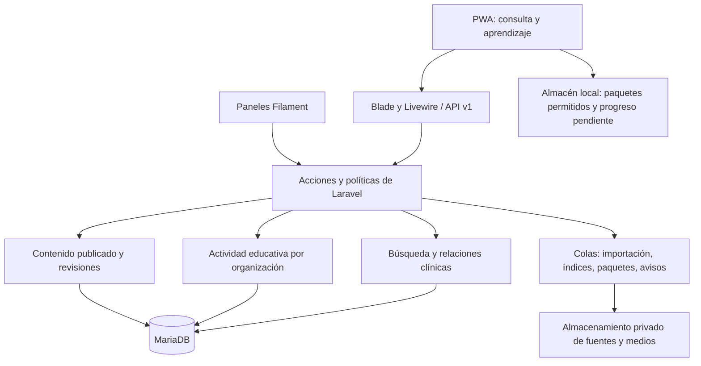

# 08. Arquitectura de aplicación y encaje del stack

> Alcance actualizado: este documento describe el producto completo. La primera implementación es el [buscador PWA estático](14_Plan_PWA_estatica.md), sin backend ni base de datos. Para esa entrega prevalecen los documentos 14-16; se conservan aquí las especificaciones compatibles y la evolución posterior.

Versión de planificación: 1.1 · 25/10/2026 · Estado: alcance ajustado a las respuestas del usuario. Este documento define la implementación futura; no afirma que exista ya una aplicación, un repositorio ni una suite ejecutada.

## 1. Decisión principal

Construir un **monolito modular Laravel 12**, con MariaDB como fuente de verdad y dos experiencias sobre los mismos servicios de aplicación:

- **Aplicación de aprendizaje y consulta:** Blade, Livewire 3 y componentes propios con Material Design 3, adaptada al móvil e instalable como PWA.
- **Gestión:** Filament 3 para contenidos, revisión médica, preguntas, cohortes, usuarios y operaciones. Sus recursos llaman a las mismas acciones que las rutas y la API; no duplican reglas clínicas o permisos.

La lista de paneles escolares incluida en el stack sirve como referencia tecnológica. Los seis perfiles confirmados son aprendiz, docente, editor, revisor clínico, administrador y superadministrador técnico; una persona puede acumular funciones autorizadas. El aprendiz puede ser de distintas profesiones sanitarias, con itinerarios y nivel de profundidad diferenciados. El primer uso será privado, con una única cuenta propietaria activa. Se conserva el diseño de permisos para el futuro, pero grupos, paneles docentes y acceso de terceros se activarán después de validar el uso individual.

La finalidad inicial es educativa y de consulta documental, con guías actuales como estructura clínica principal, contexto español y contenidos diferenciados de adultos y pediatría. El libro se conserva como fuente secundaria privada. No hay IA ni entrada de datos de pacientes reales en las primeras versiones; cualquier orientación individualizada futura necesita un proyecto de alcance y validación específico.

No se requiere React, Vue, una base de grafos ni microservicios para el primer producto. Se separan módulos y contratos para poder evolucionar cuando el volumen o la organización lo justifique.



## 2. Módulos y responsabilidades

| Módulo | Responsabilidad | Regla de frontera |
| --- | --- | --- |
| Identidad y organizaciones | Usuarios, membresías, organización activa, roles, acceso y recuperación | El cliente nunca decide su organización autorizada enviando un identificador |
| Biblioteca y fuentes | Ediciones, secciones, capítulos, páginas reales, recursos y procedencia | Un archivo o una transcripción no adquiere validez clínica por importarse |
| Editorial | Borradores, revisiones, aprobación, publicación y retirada | Autor y aprobador clínico se verifican según la política editorial |
| Conocimiento clínico | Conceptos, enfermedades, síntomas, pruebas, hallazgos, relaciones y referencias | Las relaciones conservan contexto, evidencia y versión; no son diagnósticos automáticos |
| Algoritmos y casos | Grafos validados, nodos, decisiones, casos simulados y recorrido | Evaluador determinista; sin ejecutar código procedente del contenido |
| Aprendizaje | Preguntas, sesiones, intentos, repaso, objetivos y explicaciones | Cada intento conserva las revisiones exactas utilizadas |
| Docencia | Grupos, tareas, evaluaciones y seguimiento autorizado | La actividad de una organización no se mezcla con otra |
| Búsqueda | Índice derivado, sinónimos, filtros, resultados y navegación por entidades | Solo devuelve contenido que el usuario puede consultar y cuya revisión sea válida |
| PWA y sincronización | Paquetes, manifiestos, control de versiones y recepción de actividad | El funcionamiento sin red no depende de una acción Livewire al servidor |
| Operaciones | Auditoría, colas, notificaciones, exportación y mantenimiento | Las acciones privilegiadas están autorizadas y registradas |

La estructura orientativa será `app/Domain/<Modulo>`, `app/Application/<Modulo>`, `app/Http`, `app/Livewire`, `app/Filament` y `app/Policies`. No se impone una abstracción de repositorio para cada tabla. Las acciones de aplicación coordinan transacciones; Eloquent representa persistencia y relaciones; los servicios de dominio contienen las reglas que deben probarse de forma aislada.

## 3. Versionado y modelo de publicación

Contrato compartido por toda la aplicación:

1. `content_items` representa la identidad estable de un contenido. `content_revisions` contiene sus versiones, con payload tipado y referencias a sus componentes.
2. Clave interna de MariaDB: `BIGINT UNSIGNED`. Identificador público y de sincronización: `public_id`, ULID de 26 caracteres, único. Las URL y la API no exponen el autoincremento.
3. Estados: `draft → in_review → approved → published`; una publicación anterior puede quedar `superseded` y una revisión insegura o inválida `withdrawn`.
4. El cuerpo de una revisión publicada es inmutable. Su vigencia y retirada se registran mediante transiciones y eventos auditados; una corrección crea otra revisión.
5. Cada sesión, caso, algoritmo, explicación y exportación referencia `item_public_id` y `revision_public_id`. No consulta la versión más reciente a mitad de una sesión.
6. Publicación, actualización del puntero visible y emisión del evento se coordinan dentro de una transacción. Una tabla de eventos pendientes permite reintentar indexación y empaquetado tras el commit sin perder avisos por un fallo de cola.
7. Búsqueda y paquetes son proyecciones regenerables. Las fuentes, las revisiones y la actividad son datos primarios que requieren copia de seguridad.

El contenido editorial de referencia es global. La actividad educativa, las asignaciones, el progreso y los informes están vinculados a una organización y a su usuario o grupo. No se añade `organization_id` artificial a todas las tablas de conocimiento. La autorización resuelve ambos ámbitos explícitamente.

## 4. Stack solicitado y uso concreto

| Tecnología | Aplicación prevista | Condición técnica |
| --- | --- | --- |
| PHP 8.3 CLI y pruebas / PHP 8.5 web | Un mismo código compatible con ambos intérpretes | Lockfile resuelto para el mínimo 8.3; comprobación de plataforma real en ambos |
| Laravel 12 | Rutas, acciones, modelos, colas, caché, correo, notificaciones y planificación | Fijar patch exacto mediante `composer.lock`; vigilar fin de soporte |
| MariaDB producción; SQLite y MariaDB 11 pruebas | Transacciones, relaciones e índices | Fijar minor de MariaDB 11 y cotejarlo con producción; SQLite no valida FULLTEXT ni bloqueos equivalentes |
| Filament 3 + Livewire 3 | Gestión y pantallas interactivas | Filament se configura por panel y política; versiones de plugins verificadas individualmente |
| Blade + Alpine.js | Interfaz M3 y estados locales | Alpine incluido por Livewire: evitar cargar una segunda copia |
| Tailwind CSS 3, forms, typography, PostCSS, Autoprefixer | Estilos y compilación | Configuración propia de tokens; sin cambiar a Tailwind 4 por usar un starter actual |
| `@material/material-color-utilities` | Generación de tokens CSS M3 | Tokens versionados, comprobados en claro, oscuro y alto contraste |
| `blade-tabler-icons` / `@tabler/icons` | Iconos de servidor y navegador | Resolver paquetes concretos y licencias; nombres semánticos comunes |
| Fontsource: Poppins, Nunito, Caveat, Noto Sans Arabic | Fuentes locales | Subconjuntos y pesos necesarios; Caveat solo en usos secundarios previstos en diseño |
| Vite 5 + `laravel-vite-plugin` | Activos versionados | Emparejamiento exacto de versiones, no instalación de `latest` |
| `mcamara/laravel-localization` | Rutas con idioma | Lista de idiomas admitidos y pruebas de ruta, redirección y RTL |
| `spatie/laravel-translatable` | Campos traducibles JSON | Traducción clínica revisada y vinculada a revisión; no equivale a traducción automática |
| `filament-language-switch` | Selector de idioma en gestión | Identificar y fijar el paquete Composer concreto compatible con Filament 3 |
| `spatie/laravel-permission` | Roles y permisos | Roles nuevos mediante migraciones; políticas y organización activa además del rol |
| Socialite, Laragear WebAuthn/Webpass y Sanctum | Google, passkeys, refuerzo administrativo y API | Sesión propia; recuperación y vinculación de cuentas controladas |
| `owen-it/laravel-auditing` | Registro de cambios | Cobertura explícita de operaciones masivas, transiciones y acciones privilegiadas |
| Laravel Notifications + Web Push | Campana, correo y recordatorios opcionales | Preferencias, colas, reintentos y un solo `public/sw.js` |
| Spatie Media Library | PDF, figuras y anexos | Discos privados, autorización, revisiones y hashes de integridad |
| DomPDF, Laravel Excel | Informes educativos PDF e importación/exportación | PDF con tablas; importación validada y en cola; no rehacer los PDF fuente con DomPDF |
| Bacon QR Code + jsQR | Enlaces a contenido mediante QR y lectura de cámara | QR sin credenciales ni datos personales; HTTPS y permiso de cámara |
| iCalendar `.ics` | Recordatorios de tareas optativos | Fechas coherentes con Europe/Madrid; UID estable; sin exponer progreso privado |
| Pest 3, plugin Laravel, Mockery, Faker, Collision | Pruebas y diagnóstico del desarrollo | Fijar la rama 3, no instalar Pest actual por defecto |
| Larastan/PHPStan y Pint | Análisis y estilo | Línea base que solo disminuye y código nuevo sin exclusiones generales |
| GitHub Actions y Chrome/CDP desde Node | Integración, capturas y despliegue manual | Pruebas reales reproducibles; no afirmar que 2.000 pruebas ya existen |
| Sail opcional y PHP local | Desarrollo | Entornos descritos y versiones fijadas; el servidor de desarrollo no se expone como producción |

Estos paquetes constituyen la base estricta exigida, no una obligación de activar todas sus funciones en el MVP. Se prioriza exportar apuntes y progreso; QR e ICS solo se incorporarán cuando haya un uso concreto. Los avisos de repaso y cambios relevantes son configurables; tareas y plazos se incorporan al habilitar docencia. Los paquetes de autenticación y traducción se integran según fase, sin publicar registro externo ni activar idiomas fuera de alcance por el mero hecho de instalarlos.

## 5. Compatibilidad verificada y decisiones pendientes

Comprobación documental realizada el 25/10/2026. **No sustituye resolver las dependencias completas ni ejecutar la aplicación.**

| Punto | Evidencia primaria | Decisión para el proyecto |
| --- | --- | --- |
| Laravel 12 y PHP | La tabla oficial declara PHP 8.2–8.5 y soporte de seguridad hasta el 24/02/2027; las correcciones generales terminaron el 13/08/2026 | Mantener Laravel 12 estrictamente, registrar el límite de soporte y resolver los bloqueos antes de desplegar. No queda autorizada una actualización de major. [Laravel](https://laravel.com/docs/12.x/releases) |
| PHP 8.3 / 8.5 | PHP 8.3 tiene soporte de seguridad hasta el 31/12/2027 y 8.5 hasta el 31/12/2029 | Añadir el mantenimiento de ambos runtimes al calendario; no usar sintaxis exclusiva de 8.5. [PHP](https://www.php.net/supported-versions.php) |
| Filament 3 | Documentación de mínimos y manifiesto de `filament/support` 3.x admiten Livewire 3 y Laravel 12; la rama examinada exige Livewire `^3.5` | Elegir releases publicados compatibles de todos los paquetes; esto no certifica cada plugin ni PHP 8.5 en ejecución. [Instalación](https://filamentphp.com/docs/3.x/panels/installation), [manifiesto](https://raw.githubusercontent.com/filamentphp/filament/3.x/packages/support/composer.json) |
| Vite 5 | Vite 5 es una rama antigua y queda fuera de las ramas con soporte que enumera la política actual | Mantener Vite 5 estrictamente y registrar el bloqueo si no puede obtenerse una combinación aceptable. No cambiar de major; un bloqueo no resuelto impide desplegar. [Vite](https://vite.dev/releases) |
| Plugin de Vite | El manifiesto del tag `v1.2.0` admite Vite `^5.0.0` o `^6.0.0`; el manifiesto consultado de la rama `1.x` declara otro rango | `v1.2.0` es un candidato documental, no una aprobación de seguridad. Fijar combinación exacta y comprobar advisories; `^1` sin lock no constituye una garantía. [Tag 1.2.0](https://raw.githubusercontent.com/laravel/vite-plugin/v1.2.0/package.json), [rama 1.x](https://raw.githubusercontent.com/laravel/vite-plugin/1.x/package.json) |

La opción Q26C confirma que las versiones indicadas son estrictas. Como primer trabajo técnico se hará una prueba acotada de resolución de dependencias y lockfiles, con un informe de versiones elegidas, restricciones, licencias, soporte y vulnerabilidades. Este documento no ejecuta esa prueba ni genera código de aplicación. Los bloqueos se resolverán dentro del stack autorizado y quedarán registrados; no se usarán `--ignore-platform-reqs` ni excepciones generales a auditoría. Node se fijará en una versión LTS mantenida compatible con los paquetes seleccionados. Si un parche seguro exige salir de las versiones requeridas, la combinación queda bloqueada para despliegue y se comunica la incompatibilidad; no se sustituye el stack automáticamente.

Puertas de validación de dependencias:

1. Resolver Composer con plataforma mínima 8.3 y conservar `composer.lock`; ejecutar `composer validate`, `composer audit` y `composer check-platform-reqs` en cada runtime real.
2. Resolver npm con su lockfile, instalar con `npm ci`, revisar dependencias de desarrollo y producción y ejecutar build limpio.
3. Ejecutar matriz PHP 8.3/8.5 y SQLite/MariaDB 11 con el mismo lockfile y errores deprecados visibles.
4. Probar acceso, edición, subida, traducción y exportación en Filament; verificar WebAuthn y compilación M3 en el navegador.
5. Registrar extensiones: las de Laravel y las adicionales realmente exigidas por paquetes, como `intl`, drivers PDO, ZIP y las de imágenes; comprobar CLI, FPM y workers por separado.

## 6. Contratos HTTP y uso de la API

Rutas de interfaz con prefijo de idioma; rutas API versionadas `/api/v1` con idioma explícito. La API ofrece recursos limitados para búsqueda, lectura publicada, paquetes y sincronización. No expone CRUD arbitrario de todas las tablas.

| Operación propuesta | Contrato esencial |
| --- | --- |
| `GET /api/v1/search` | Consulta y filtros validados, cursor, límite máximo, idioma y disponibilidad; respuesta con revisión, página y fragmento |
| `GET /api/v1/items/{item_public_id}` | Revisión publicada visible; permite pedir una revisión histórica si el usuario tiene acceso; retira de consulta lo revocado |
| `GET /api/v1/offline-packs/{pack_public_id}/manifest` | Derecho de descarga, alcance, versión de esquema, revisiones y hashes |
| `POST /api/v1/attempts/batches` | Lote de eventos con ULID, idempotencia, revisiones y resultados independientes por evento |
| `PUT /api/v1/bookmarks/{item_public_id}` | Operación idempotente, contexto de usuario/organización resuelto en servidor |
| `POST /api/v1/content-reports` | Incidencia sobre revisión y página, sin datos de pacientes; límites y seguimiento |

Todos los nombres y rutas son contratos propuestos que se congelarán en OpenAPI 3.1 antes de implementar la PWA. Los identificadores públicos de ejemplo no se confunden con claves internas. Una respuesta de lectura incluirá como mínimo:

```json
{
  "item_public_id": "01JZ0000000000000000000001",
  "revision_public_id": "01JZ0000000000000000000002",
  "schema_version": "1.0",
  "content_type": "topic",
  "locale": "es",
  "editorial_status": "published",
  "reviewed_at": "2026-10-25T09:00:00Z",
  "citations": [{ "locator_kind": "pdf", "source_public_id": "01JZ0000000000000000000009", "locator_public_id": "01JZ0000000000000000000010", "source_version": "edicion-ejemplo", "document_public_id": "01JZ0000000000000000000008", "original_page_start": 157, "original_page_end": 158 }],
  "payload": { "title": "Ejemplo de estructura" }
}
```

El ejemplo muestra un localizador PDF, no el único formato de cita. Sus páginas y versión solo ilustran el contrato; no constituyen una cita clínica. Las guías web usan `locator_kind: web`, los mismos `source_public_id`, `locator_public_id` y `source_version`, más `url`, `section_label` y `retrieved_at`, sin páginas PDF ficticias. La edición del libro solo se referencia cuando esa fuente corresponda; no es un requisito de todas las citas. El contrato canónico de ambos localizadores se mantiene en [12_Contratos_y_criterios_transversales.md](12_Contratos_y_criterios_transversales.md).

Las unidades, valores numéricos y criterios de algoritmos se transmiten con campos tipados, nunca se reinterpretan a partir de texto localizado. El servidor valida el payload con un esquema versionado y límites de tamaño/profundidad. No admite expresiones PHP/JavaScript ni `eval`.

Errores estables: `401` sesión requerida, `403` acceso denegado, `404` recurso no visible, `409` conflicto de versión/idempotencia, `410` revisión retirada cuando proceda revelar ese estado, `422` datos inválidos y `429` límite de uso. Los mensajes se traducen; los códigos de máquina son estables.

Para el cliente propio se usan cookies de sesión y CSRF mediante Sanctum, sin bearer tokens en `localStorage`. Los tokens personales quedan reservados a integraciones futuras aprobadas. Esta distinción coincide con el modelo de autenticación oficial de [Sanctum](https://laravel.com/docs/12.x/sanctum).

## 7. Rendimiento y colas

La búsqueda empieza con proyecciones e índices MariaDB, relaciones indexadas, sinónimos revisados y paginación; no se añade un motor externo antes de medir. Un adaptador `SearchProvider` permitirá otra implementación si relevancia, morfología multilingüe o volumen lo exigen. La versión SQLite solo verifica contrato y lógica común; los tests de relevancia, colación, JSON y FULLTEXT se ejecutan en MariaDB.

Claves de caché incluyen organización o audiencia autorizada, idioma, revisión y versión del índice. Nunca se comparte una caché de informes personales con la biblioteca global. Al publicar se construye la nueva proyección, se verifica y se cambia el puntero; al retirar se invalida además el acceso, sin esperar a la reindexación completa. Las páginas nunca cargan el libro entero ni cientos de relaciones en cascada.

Colas separadas: `imports`, `indexing`, `offline-packs`, `exports` y `notifications`, con prioridades, reintentos limitados e idempotencia. El usuario recibe un estado de trabajo; no espera un OCR o un PDF en la petición interactiva. Driver de base de datos inicialmente; Redis solo si se justifica por mediciones y operación disponible. Laravel permite ambos modelos de cola. [Colas de Laravel](https://laravel.com/docs/12.x/queues).

## 8. Idiomas y dirección de lectura

- Piloto: interfaz y contenido clínico en español `es` e inglés `en`, ambos con revisión clínica y lingüística. La cobertura publicada se mide por separado para cada idioma; no se presenta un borrador inglés como traducción validada.
- Catálogo posterior: árabe `ar`, darija latino `ary-Latn` y darija árabe `ary-Arab`, con códigos y nombres visibles que se confirmarán al activar esa fase. Se preparan dirección lógica y estructura de traducción desde el inicio; no se exige traducir a esos idiomas en el piloto. El código de idioma no se deduce del alfabeto del usuario.
- Los textos de interfaz se mantienen en `resources/lang` como exige el stack. Laravel se configura explícitamente para usar esa ruta; no se presupone que sea la ruta predeterminada de una instalación reciente.
- Traducciones de contenido con Spatie dentro de la revisión correspondiente, con idioma fuente, estado de revisión y fecha. Si la versión clínica traducida no está aprobada, se ofrece la fuente con etiqueta clara; no se muestra una traducción antigua como equivalente.
- Idiomas RTL con `dir="rtl"`, propiedades CSS lógicas y pruebas de números/unidades, tablas, navegación y diagramas. Códigos, fórmulas y unidades conservan su dirección semántica.
- URLs y caché varían por idioma; fechas de eventos se almacenan en UTC y se presentan en Europe/Madrid o la zona elegida por el usuario. Los vencimientos clínicos y los avisos no dependen del reloj del móvil.

## 9. Decisiones confirmadas y puntos pendientes

Quedan confirmados stack estricto, inicio privado individual, seis roles, español e inglés desde el piloto, lectura y tests formativos sin conexión y ausencia de IA en las primeras versiones. La modalidad futura será registro abierto con aprobación; durante la fase privada, una bandera de configuración mantiene desactivado el registro externo y solo la cuenta propietaria tiene acceso activo. Una solicitud pendiente nunca equivale a una membresía activa ni permite descargar contenido.

La estructura clínica sigue guías actuales y usa el libro como referencia secundaria. Convertir un PDF en filas, JSON o Markdown no elimina sus derechos: las fuentes, los extractos y las derivaciones conservan procedencia y ámbito de uso; el material del libro no se incorpora a paquetes para terceros sin cobertura acreditada. La aplicación privilegia contenido estructurado propio y revisado.

Siguen pendientes escala real, hosting/correo, presupuesto operativo y equipo de revisión. La falta de revisores no impide desarrollar el esquema, usar fixtures sintéticas ni importar material a borrador privado; bloquea publicar contenido clínico que requiera esa revisión. Se trabajará por hitos sin fecha cerrada y con dedicación personal limitada. El funcionamiento offline, seguridad y operación se detallan en [09_PWA_seguridad_y_operacion.md](09_PWA_seguridad_y_operacion.md), y las puertas de entrega en [10_Plan_de_implementacion_y_calidad.md](10_Plan_de_implementacion_y_calidad.md).
