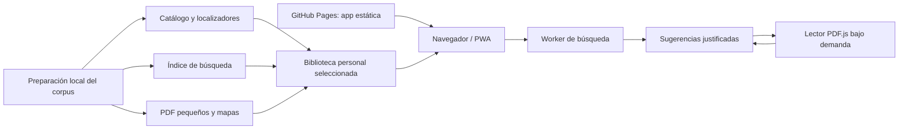

# Primera implementación: PWA estática y buscador documental

Versión 2.0 del alcance técnico. Este documento y los documentos [15](15_Buscador_local_y_relevancia.md) y [16](16_PDF_navegacion_y_publicacion.md) prevalecen para la primera implementación. Los diseños Laravel/MariaDB anteriores quedan como evolución posterior, no como requisito para construir este buscador.

## 1. Objetivo concreto

Escribir una frase con síntomas, antecedentes, anamnesis, diagnósticos o términos de interés; recuperar los fragmentos más relacionados de todo el material disponible; ver por qué coinciden; abrir el PDF pequeño en su página exacta y, cuando se haya localizado, en la subsección concreta. Volver a las sugerencias conservando frase, filtros, orden y posición.

El buscador recupera información documental. Su puntuación mide conexión con la consulta, no probabilidad de una enfermedad. La aplicación no emite un diagnóstico, no transforma un resultado de laboratorio en una certeza y no necesita introducir datos personales de pacientes para funcionar.

Ejemplo de interacción, sin dar una respuesta clínica:

```text
Consulta: «disnea, taquicardia y dolor torácico»

Resultados:
  Sección > capítulo > subsección
  Fragmento donde aparecen los términos o sus sinónimos
  Coincidencias encontradas y términos no encontrados
  Contexto: población, fuente y estado del texto
  [Abrir aquí] [Ver capítulo] [Otra sugerencia]

Lector:
  PDF del capítulo, página local N / página original M
  Ancla de subsección o zona resaltada si está verificada
  [Volver a resultados] [Sugerencia anterior] [Siguiente sugerencia]
```

## 2. Qué cambia frente al plan anterior

| Decisión | Primera implementación actual | Evolución posterior |
| --- | --- | --- |
| Ejecución | HTML, CSS y JavaScript en el navegador | Backend sólo si se necesita |
| Alojamiento del código/app | Repositorio privado previsto **jmgo93/urgencias-pwa**, con creación remota pendiente; GitHub Pages se configurará después de implementar y verificar el acceso mediante contraseña | Revisar hosting al ampliar acceso/funciones |
| Datos | Archivos de catálogo, fragmentos e índices generados previamente | Base relacional del plan anterior cuando proceda |
| Base de datos | Sin MariaDB, SQLite ni IndexedDB en esta fase | Decisión posterior |
| Búsqueda | Local, en un Web Worker, sin enviar la frase al servidor | Un proveedor remoto sólo por nueva decisión |
| Contenido | Biblioteca documental existente y fuentes adicionales autorizadas | Fichas clínicas actuales revisadas, tests y casos |
| Perfiles y altas | Sin cuentas ni registro en el buscador estático personal | Roles y aprobación requieren servicio de identidad real |
| IA | No se utiliza | Sigue fuera de las primeras versiones |
| PDF | Visor integrado y archivos pequeños bajo demanda | Mantener la misma trazabilidad al migrar |
| Progreso | Estado temporal de navegación; guardados locales opcionales | Sincronización multiusuario futura |

«Sin base de datos» no significa buscar directamente en 1.101 páginas PDF cada vez: la preparación genera archivos estáticos de datos e índices. Son artefactos del corpus, no un servicio de base de datos ni un proceso servidor.

El usuario ha confirmado **jmgo93**, la cuenta conectada, como destino correcto; sustituye la referencia anterior **jmago93**. El nombre elegido para el repositorio es **urgencias-pwa**. Esta decisión no significa que el repositorio remoto o la publicación de Pages ya existan.

Requisito posterior: desbloqueo con contraseña conforme al [documento 17](17_Acceso_con_contrasena.md). Se protege contenido mediante cifrado y descifrado local, sin cuentas ni contraseña incrustada en JavaScript. La biblioteca local continúa como modalidad inicial. Los costes de arranque y apertura se medirán con descifrado incluido.

La prioridad actual es buscar y leer. No hacen falta autenticación, Filament, permisos de grupos, colas de servidor ni un motor docente para demostrar ese recorrido. PHP/Laravel/MariaDB se aplazan; no se ejecutan en GitHub Pages. El diseño Material 3, las fuentes locales, los iconos y las convenciones de accesibilidad se conservan. El build puede mantener Vite 5 y Tailwind 3 si su combinación exacta supera las comprobaciones; la fase estática no autoriza actualizar versiones fijadas ni obliga a resolver Composer.

## 3. Qué publicar y qué mantener personal

El uso privado del libro y la ausencia de permiso de distribución siguen vigentes. Repositorio privado y sitio Pages privado no son conceptos equivalentes; las funciones de publicación privada dependen del plan y configuración de GitHub. [Documentación oficial de publicación de Pages](https://docs.github.com/en/pages/getting-started-with-github-pages/creating-a-github-pages-site).

**Modalidad inicial propuesta:** GitHub contiene la aplicación, su documentación, pruebas y un corpus de demostración propio. El corpus personal del libro —PDF, transcripciones, fragmentos e índices que reproduzcan su texto— se genera y conserva localmente. Al abrir la PWA se selecciona la biblioteca personal; la búsqueda y la lectura se ejecutan en el dispositivo. No se sube a GitHub por tener un formato JSON.

Esto permite alojar la app estática en Pages sin publicar automáticamente el libro ni su índice textual. Preparar un `.gitignore` no basta si un archivo ya entró en el historial: el primer commit y el artefacto de Pages deben comprobarse por lista de archivos permitidos. No habrá credenciales GitHub en JavaScript ni una contraseña visual que finja proteger archivos públicos.

La persistencia del corpus en el navegador será opcional mediante Cache Storage y un botón explícito; no requiere IndexedDB. Si no se conserva o el navegador lo elimina, hay que seleccionar de nuevo los archivos personales. El detalle, limitaciones móviles y alternativa con fuentes alojadas legalmente se especifican en el documento 16.

## 4. Material medido y trabajo pendiente

| Inventario local actual | Medida |
| --- | ---: |
| Páginas originales y anclas de página en Markdown | 1.101 |
| PDF divididos | 25 |
| Capítulos | 198 |
| Casos clínicos | 45 |
| Entradas de capítulos/casos en conjunto | 243 |
| Texto Markdown completo, con cabeceras y referencias | 5.117.946 bytes, aproximadamente 4,88 MiB |
| PDF divididos en conjunto | 296.987.367 bytes, aproximadamente 283,23 MiB |
| PDF de sección mayor | 62.998.566 bytes, aproximadamente 60,08 MiB |
| Original completo | 298.005.200 bytes, aproximadamente 284,20 MiB |

Los tamaños son medidas de los archivos existentes, no del índice futuro. No se han creado todavía los PDF por capítulo ni los fragmentos de subsección. Los 243 registros del manifiesto no son 243 capítulos: incluyen los 45 casos.

El texto ya extraído permite construir el índice sin procesar los PDF durante una consulta. Falta revisar límites de subsecciones, orden de columnas y localizadores de figuras/tablas; en 32 páginas el texto procede de OCR y puede contener errores. Una coincidencia documental no equivale a una afirmación clínicamente actualizada.

## 5. Preparación del corpus en el ordenador

La preparación se ejecuta localmente, antes de abrir la app. Produce resultados reproducibles y puede repetirse sin duplicar registros:

1. Leer manifiesto, mapas y transcripciones existentes; comprobar hashes y recuentos.
2. Reconstruir secciones, capítulos, casos, epígrafes y subsecciones. Los encabezados dudosos se revisan con la página original.
3. Segmentar en pasajes que conserven sentido y contexto. No cortar una tabla o algoritmo como si fuese texto narrativo ordinario.
4. Normalizar términos para búsqueda manteniendo siempre texto original, página y ámbito.
5. Añadir glosario acotado de siglas, variantes y sinónimos revisados. No inventar asociaciones clínicas para ampliar resultados.
6. Generar un índice invertido precompilado y un catálogo pequeño con jerarquía y localizadores.
7. Crear, cuando se implemente, PDF por capítulo/caso y mapas de páginas. Mantener sección completa como alternativa para el contexto; original sin cambios.
8. Registrar versión, esquema, hashes, tamaños y estado de verificación de cada activo.
9. Comprobar que cada resultado del conjunto de referencia abre el documento y página esperados.

El corpus seguirá identificado como libro de 2018. El buscador documental puede indexar transcripciones con etiqueta de calidad sin presentarlas como fichas clínicas revisadas. La app clínica posterior seguirá el acuerdo de guías actuales principales; la nueva primera fase no revalida el libro ni sustituye aquellas guías.

## 6. Arquitectura estática mínima



Estructura orientativa, no archivos ya creados:

```text
repositorio-app/
  src/
    app/                 # rutas, estado y componentes
    search/              # cliente y Web Worker
    reader/              # integración PDF.js y localizadores
    styles/              # tokens Material 3 y componentes
    i18n/                # interfaz español/inglés
  public/
    manifest.webmanifest
    icons/
  fixtures/demo/         # sólo contenido propio de prueba
  tests/
  .github/workflows/    # comprobaciones y publicación de app

corpus-personal/         # fuera del repositorio y del artefacto Pages
  content-manifest.json
  catalog/
  index/
  fragments/
  pdf/
  page-maps/
```

Nombre contractual del manifiesto: `content-manifest.json`. Catálogo, índice y archivos se resuelven mediante rutas y hashes del manifiesto, no concatenando nombres a partir de la consulta. Los documentos 15 y 16 detallan los contratos de búsqueda y localización. Puede empezarse con un solo índice de texto si las medidas lo permiten; no se impone fragmentación prematura del índice.

PDF.js y el motor de búsqueda se fijan a releases concretos después de verificar compatibilidad y licencias. Se empaquetan con la app; no dependen de descargar código de un CDN en cada uso. El worker de búsqueda y el worker de PDF.js son responsabilidades distintas.

## 7. Recorrido de interfaz prioritario

### Pantalla de búsqueda

- Campo principal amplio para escribir o pegar una frase breve; botón Buscar y atajo de teclado.
- Filtros opcionales: sección, tipo, adultos/pediatría, fuente y alcance local disponible.
- Términos reconocidos, siglas ambiguas y términos sin equivalencia; el usuario puede corregirlos.
- Primeros resultados útiles sin esperar a cargar PDF. Un fragmento y su ruta jerárquica explican la coincidencia.
- Diferenciar «mejor coincidencia en el texto», «coincidencia parcial» y «relacionado mediante un término revisado»; no mostrar porcentajes clínicos.

### Resultado

Mostrar título de subsección, capítulo, sección, página original, coincidencias resaltadas, breve contexto, fuente/edición y calidad del anclaje. Una tarjeta puede agrupar varios pasajes del mismo capítulo para no llenar la lista de duplicados.

Acción principal «Abrir aquí». Acciones secundarias «Ver contexto», «Ver otras coincidencias de este capítulo» y «Buscar este término». La ficha no promete una subsección exacta si sólo se verificó la página.

### Lectura y vuelta a sugerencias

En escritorio: resultados a un lado y visor al otro. En móvil: búsqueda → resultado → lector, con «Volver a resultados» visible y sugerencias anterior/siguiente sin rehacer la consulta. Cada cambio conserva un snapshot de consulta y filtros, orden, resultado seleccionado, scroll, documento y página.

La consulta clínica no se incluye por defecto en la URL, en logs ni en telemetría. Las rutas hash pueden contener identificadores documentales no sensibles; el texto y snapshots viven en memoria de la sesión. Persistir historial será una opción explícita. Al recargar sin estado, abrir el documento enlazado y ofrecer una nueva búsqueda, sin fingir que se conserva un contexto perdido.

El botón Atrás del navegador debe recuperar el snapshot vigente, sin duplicar búsquedas ni perder la posición. Las respuestas atrasadas del worker no pueden reemplazar resultados de una frase posterior. El lector conserva la escala al cambiar de sugerencia cuando sea compatible.

## 8. Cómo lograr rapidez de forma comprobable

- Buscar sobre texto preprocesado, nunca recorrer PDF/OCR durante cada consulta.
- Cargar catálogo y motor ligero antes que el visor PDF; PDF.js se importa al abrir un resultado.
- Un worker realiza tokenización, búsqueda y ordenación sin bloquear escritura ni scroll.
- Reutilizar el índice ya cargado y los PDF abiertos, con límites de memoria; cancelar búsquedas y renderizados obsoletos.
- Abrir sólo el capítulo/página seleccionados. No cargar las 25 secciones ni crear un canvas para cada página.
- Mantener la consulta y los resultados al volver del lector: no volver a descargar ni recalcular sin necesidad.
- Precargar como máximo una página vecina cuando el usuario esté leyendo; no descargar PDF por cada sugerencia.
- Usar archivos versionados y un service worker de caché explícita para la app; corpus personal por elección, sin precaché masiva.

### Presupuestos iniciales propuestos, todavía sin medir

| Medida | Objetivo para el piloto | Condición de medición |
| --- | --- | --- |
| Búsqueda con índice listo | p95 ≤ 150 ms en worker | Corpus completo, consultas acordadas, dispositivo de referencia |
| Presentar primeros resultados | p95 ≤ 250 ms tras enviar | Incluye actualización de interfaz; separar carga inicial |
| Volver a sugerencias conservadas | p95 ≤ 100 ms | Snapshot en memoria, sin nueva consulta ni carga PDF |
| Abrir primera página de capítulo local | p95 ≤ 1 s | Archivo pequeño disponible, móvil de referencia, zoom inicial |
| Arranque y carga inicial del índice | Medir antes de fijar presupuesto | Registrar bytes, lectura local/red, parseo, memoria y tiempo de importación |

No se garantiza «instantáneo» en cualquier dispositivo. Primero se medirán tamaño del índice, parseo y memoria con los 4,88 MiB de transcripción. Sólo si excede presupuesto se introducirán shards; cualquier carga progresiva indicará cobertura parcial y nunca presentará una búsqueda incompleta como cruce de todo el corpus.

## 9. Hitos pequeños de implementación

| Hito | Entregable concreto | Condición de salida |
| --- | --- | --- |
| E0. Corpus y rutas | Esquemas estáticos, inventario y corpus de demostración propio | Mapas base 1 y hashes comprobados; ninguna fuente privada en repo/artefacto |
| E1. Preparación documental | Capítulos, subsecciones verificadas y fragmentos con citas | Todo fragmento tiene página; los anclajes dudosos están etiquetados |
| E2. Buscador funcional | Consulta local con varias palabras/frases, filtros y explicación | Conjunto de consultas de referencia; sin carga PDF ni llamadas remotas de búsqueda |
| E3. Visor exacto | PDF pequeño y salto de página/ubicación verificado | Comparación con original; anterior/siguiente y vuelta conservan estado |
| E4. Relevancia | Glosario revisado, cobertura conceptual, agrupación y sugerencias | Evaluación con casos positivos, ambiguos, negativos y sin respuesta |
| E5. PWA y biblioteca personal | Instalación, selección del corpus, caché opcional y recuperación | Móvil real, sin red, reinicio, cuota y nueva selección probados |
| E6. Publicación de la app | Pages con assets y demo permitidos, rutas bajo subdirectorio | Primera apertura, enlace directo, build nuevo y rollback comprobados |

Se puede validar E2/E3 con una muestra propia antes de preparar todo el corpus personal. Después el índice debe demostrar búsqueda global, incluyendo los capítulos grandes y las páginas OCR. El primer entregable de uso real es buscar → fragmento → página → volver, no un panel de administración.

## 10. Pruebas de aceptación prioritarias

1. Consulta con tres conceptos recupera pasajes relacionados y explica dónde coincide cada uno; no confunde cobertura con certeza diagnóstica.
2. Siglas, sinónimos, acentos, flexiones y errores comunes se resuelven con reglas probadas; una sigla ambigua no se expande silenciosamente.
3. Negación y contexto no se pierden: «sin X» no se presenta como presencia confirmada de X.
4. Todo resultado abre documento y página correctos; subsección o zona sólo si el localizador está verificado.
5. Volver conserva frase, filtros, orden y scroll; cambiar de sugerencia no descarga el libro entero.
6. Consulta y PDF se ejecutan localmente; las herramientas de red no muestran envíos del texto ni peticiones a un buscador remoto.
7. El corpus personal no figura en el repositorio publicado, historial de Git ni artefacto de Pages.
8. Funciona bajo la ruta de proyecto `/<repositorio>/`, con manifest, workers, fuentes, chunks y cachés en el ámbito correcto.
9. El modo sin red diferencia app disponible, corpus seleccionado/cacheado y archivo ausente; no muestra una descarga incompleta como lista.
10. Una actualización del corpus invalida localizadores e índices incompatibles en conjunto y conserva la versión anterior hasta completar la nueva.

## 11. Lo que se conserva para después

La base de datos, roles, revisión editorial multiusuario, docencia, evaluación y notificaciones del plan anterior siguen como posibilidades posteriores. El buscador estático conservará IDs, versiones, fuentes y mapas exportables para que se pueda migrar sin rehacer la documentación. En esta fase no hay usuarios autenticados, sincronización entre dispositivos ni aprobación real de altas.

Español e inglés siguen siendo objetivo del producto: el piloto documental debe identificar el idioma real de cada fuente. Un glosario bilingüe permite consultas equivalentes sólo donde haya mapeo revisado; no traduce automáticamente el libro ni acredita una traducción clínica inexistente.

Este encargo entrega el plan revisado. Todavía no crea el repositorio, no publica archivos y no genera nuevas extracciones PDF o índices.
